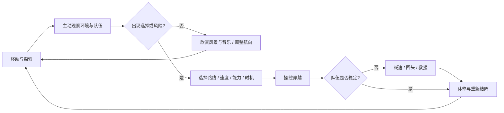

# 羽与潮 · Feather & Tide

> **2026-11-18 决议更新：** [ADR-010](docs/adr/010-journey-only-entry.md) 已取消漫游。当前流程为生物选择 → 有引导的旅程；下文未修订的双模式内容仅为历史设计，以 ADR-010 为准。

## 游戏玩法设计文档（Game Design Document）v2.0

**关键词：** 2.5D 水彩世界 / 双手实时操控 / 迁徙闯关 / 队伍协作 / 主动观察 / 动态音乐 / 环境叙事 / 十年传承  
**开发平台：** 原生 Web，Three.js + TypeScript；优先兼容桌面与 iPhone / iPad 横屏浏览器  
**文档状态：** 作为新版玩法目标与原型验收基准；**所有数值、时长与频率均为设计初值，未经试玩验证**。

> **一句话概念**：你不是独自穿越风景的旅行者，而是一支迁徙队伍的领队。左手引导方向，右手观察世界并决定何时使用能力；在风、光、水流与人类设施之间不断做出取舍，带领每一位同伴抵达远方。世界以水彩、音乐和自然声景回应你的行动。

> **版本关系与优先级**：本文件是对 v1.1 的**有意玩法升级**，不是无差异转录。继承 v1.1 的主题、三物种主线、队伍、能量/凝聚、救援、检查点、双模式和全年份逻辑；将“右侧只有专属按钮、镜头主要自动跟随”升级为“右侧可主动控制视角，且保留专属按钮”，并提高每段关卡的观察与操作密度。**玩法交互规则以本 GDD v2.0 为准；此前 TDD v1.0 中与视角/输入冲突的部分必须通过 ADR 更新后再实施。** 未修改的 v1.1 规则继续生效。

---

# 01. 游戏定位与体验承诺

## 1.1 游戏定位

《羽与潮》是一款**可操作、有连续挑战、同时值得驻足欣赏的迁徙冒险游戏**。场景使用 Three.js 呈现水彩质感的三维世界，玩法维持易于理解的 2.5D 运动逻辑：玩家操控队伍领队，跨越不同地形与环境阻碍，保护同伴，最终全队抵达迁徙落脚地。

游戏不是纯观景步行模拟器，也不是追求反应极限的动作竞速。它的乐趣来自一段持续发生的互动链：**向前移动 → 主动观察 → 识别信号 → 调整路线与速度 → 决定是否使用能力 → 保护队伍 → 享受穿越后的风景与音乐**。

## 1.2 五项体验支柱

| 支柱 | 玩家应该感受到什么 | 可验证的设计要求 |
|---|---|---|
| **始终在驾驶** | “队伍现在怎样前进，是我决定的。” | 关键路线需要手动转向/调速；松手不进入自动驾驶；不设置强制自动通关段 |
| **始终在观察** | “远处的画面蕴含对下一步有用的信息。” | 右侧拖动视角可提前发现岔路、风场、队尾与安全通道；预警不会只藏在镜头外 |
| **持续做选择** | “快、稳、绕行、结阵、救援各有代价。” | 每段具备至少一个明确的路线、能力、速度、队形或时机取舍 |
| **同伴值得照顾** | “抵达不只关乎我自己。” | 同伴状态真实改变玩家决策；必须全队抵达；失败可重试，不做死亡或惩罚统计 |
| **风景值得欣赏** | “越过难点后，有一刻音乐与自然属于我。” | 设低风险观景窗口；视觉和音乐可回应行为，但不会用欣赏行为作为失败理由 |

## 1.3 三种体验情绪

**流动（Flow）**：稳定飞行、游动或行走；轻微调整方向；画面与音乐展开。  
**专注（Focus）**：风、船、道路、围栏和岔路引发短时空间判断与操作。  
**释然（Release）**：脱离危险、接回同伴、进入湿地或海湾，声景舒展，玩家重新建立节奏。

基本节奏应为：**流动 → 发现 → 准备 → 穿越 → 释然**，然后进入下一组挑战。*“持续决策”指始终有可理解的行动选择，不指每一秒都有惩罚计时或必须连续狂按按钮。*

## 1.4 不变的创作原则

- 无说教式生态文案；环境变化通过体验呈现。
- 不做动物死亡、不减少队员人数、不做道德分或失败次数榜。
- 人类设施既可能构成阻碍，也有保护湿地、熄灯建筑、动物通道、安静航道等正向对照。
- 旅程模式允许分段重试；漫游模式无失败与压力倒计时。
- 不做签到、限时活动、错过永久失去的内容。
- 生物习性为艺术化的游戏表达，不作为科学事实；鲸的具体种属需后续确定。

---

# 02. 目标玩家体验与基础循环

## 2.1 一次典型的 20–30 秒体验（示意）

| 玩家看到 / 听到 | 玩家操作 | 内在问题与结果 |
|---|---|---|
| 芦苇随风倾斜，远处天空出现流动风痕 | 左摇杆保持巡航；右侧拖镜头看前方 | “风往哪儿吹？要不要换路？” |
| 湖岸与山口同时进入视野 | 右侧转镜观察两路，再向目标方向转向 | “走近而险，还是远而稳？” |
| 顺风直线逐渐延伸 | 按住右侧“结阵”，保持直线 | “省能量，但之后转向会慢。” |
| 前方急弯与风机边缘开始出现 | 松开结阵，左手提前缓转，右手核对外围路线 | “现在需要机动性。” |
| 成功绕过障碍，音乐由紧收回到开阔 | 放缓速度，平滑回到主路 | “我们通过了，还有同伴跟着我。” |

> 这一段是**目标体验样例**，不是强制每 20–30 秒出现一次风机。关卡的节奏需要随着场景主题变化，避免模式化重复。

## 2.2 核心玩法循环



## 2.3 关卡中的三类决策

| 决策类型 | 典型问题 | 对应系统 |
|---|---|---|
| **空间决策** | 我该从哪里绕过去？前方到底是通道还是危险？ | 右侧镜头观察、左侧移动、地形与危险轮廓 |
| **资源决策** | 加速值得吗？该结阵省力还是保持转向能力？ | 能量、凝聚、物种能力、补给 |
| **关系决策** | 队尾跟得上吗？是否要减速或折返接应？ | 队形、同伴状态、救援、全队胜利 |

**禁止伪决策**：如果一个选择既不改变路线、操作、风险、反馈，也不改变后续体验，就不应作为强制交互出现。

## 2.4 有效的“持续参与”密度（待测试）

- 在**非安全的常规路段**，建议每约 **6–12 秒**有至少一个可观察的信息变化（风向、队伍状态、道路迹象、岔路远景、音乐层次等）；不等于强制点击。
- 建议每约 **15–30 秒**出现一次需要玩家主动应对的**明确操作或取舍**；其中连续复杂操作不宜密集堆叠。
- 每完成一组较紧张的挑战，安排约 **10–25 秒**低风险流动/观景区；只要保持基本导航即可，不用应对高强度惩罚。
- 在明确标记的安全栖息地，允许玩家自由看景、听音乐、调整视角或暂停，**没有隐藏压力计时**。

这些只是关卡节拍的测量起点。试玩应以疲劳感、无聊感、紧张感和沉浸感共同评估，而非机械满足秒数。

**三物种操作节奏试调。** 每条旅程选择一个安全开场、一个主要操作题和一个后续应用。开场以巡航后 12 秒内可见方向或速度决策为试玩目标。主要操作题的宽路与短路都要求调整方向或速度；适时使用物种能力可节省时间或保持队形。晚转、错过空档后仍可重新对准、缓行集队或选择宽路。

- 雁 S0 先读芦苇转向点，转正后试滑翔。S1 先读滑翔伞，再选宽水面绕浅滩或解阵斜切、借风结阵、短加速后收速。S5 在阵风减弱时切入背风水道，转正再结阵，并按实际队尾距离调整速度。
- 鲸 W0 在鱼群处分辨水面弯线与浅潜顺流。W1 先循浮标绕防波堤，再等水面空档或全队深潜穿越。最后一只过船道后提示上浮。W3 近航道提示噪声空档后的静水，安静航道提示转向第二股流或在礁间上浮。
- 鹿 R0 提前辨认雪堆两侧蹄迹，转弯后根据实际队尾收速或呼唤。R2 对准围栏缺口并保持直行，队尾过栏后再转向。R3 使用原尘雾周期及更近的背风地。天气合适时稳速穿越，窗口偏短时在背风地集队或从岔口走恢复带。

---

# 03. 操作方案 v2.0：左侧移动，右侧视角 + 能力

## 3.1 横屏双手布局

```text
┌──────────────────────────── 游戏画面 ────────────────────────────┐
│ [暂停]              风景 / 路线 / 预警 / 队伍              [镜头复位] │
│                                                                  │
│       领队与队伍                    前方危险、岔路、地标          │
│                                                                  │
│   ┌───────────┐                     ┌─────────────────────┐       │
│   │ 左手移动区 │                     │ 右手自由观察区       │       │
│   │ 浮动摇杆   │                     │ 空白处拖动 = 转镜头   │       │
│   └───────────┘                     │            ┌──────┐  │       │
│                                     │            │能力键│  │       │
│                                     └────────────┴──────┴──┘       │
└──────────────────────────────────────────────────────────────────┘
```

**布局约定（原型建议）**：左侧约 40% 为摇杆起始区；右侧约 55% 的空白区域用于视角拖动；右下角固定物种能力按钮；右上角为镜头复位；暂停与顶部提示避开手指遮挡。以上是功能区域，不表示视角区域必须画出常驻边框。

**关键冲突消解**：右手“在空白区拖动”只转动镜头；**从能力按钮按下**的指针只控制能力，不转镜头。输入在按下瞬间绑定角色，拖过其他区域也不改变职责。

## 3.2 左手：移动摇杆

- 任意按下左侧可用区域时生成浮动摇杆；推动方向为角色的目标移动方向，力度决定缓行、巡航、加速档位。
- 死区建议约 **10%**；外圈约 **90%**以上进入加速，能耗明显升高。
- 角色按照物种的转向上限逐步调整，不瞬间掉头；不自动绕过危险或替玩家选路。
- **控制基准**：推荐“屏幕/当前镜头相对方向”映射到水平游戏平面。镜头转动时，角色既有转向惯性与方向变化速率限制；右手快速转镜不能让队伍瞬间变向。实现细则与手感需要单独实测。
- 松开后保留物种区别：雁短暂滑翔后低速盘旋；鲸惯性滑行数秒后悬浮；驯鹿数步内停下。松手不是自动驾驶或安全避险。
- **桌面映射**：WASD/方向键移动；可选 Shift 加速，键盘速度档位与手柄对应，并在设置中提供键位提示。

## 3.3 右手：主动视角

### 基本动作

| 操作 | 对镜头的影响 | 对模拟移动的影响 |
|---|---|---|
| 右侧空白区域单指拖动 | 水平环绕 / 小幅俯仰 | **不直接移动角色** |
| 松开右侧拖动 | 镜头平滑停在新构图 | 角色继续遵循左手输入与物种惯性 |
| 点按“镜头复位” | 平滑回到默认前向跟随构图 | 不修改领队朝向、速度或能量 |
| 接近岔路 / 危险 | 系统可轻微拉远、提供构图引导 | 不抢夺移动控制权 |
| 按住右下能力按钮 | 激活物种能力（有形成和解除时间） | 按能力规则改变队伍/角色行为 |

### 视角限制

**默认采用斜俯视 2.5D 跟随镜头**，右手不是无限自由飞行摄像机。斑头雁章节支持鼠标或触摸连续 **360° 水平环绕**，经典档与触屏的俯视角为 **35°–65°**。桌面可在设置中开启默认关闭的正交「宽幅鼠标环绕」，上限与下限为 **20°–80°**，地形和设施遮挡时临时抬高。其他物种的观察范围待原型验证。镜头始终围绕领队或队伍关注点，避免穿地、穿建筑、翻转或丢失领队。

镜头复位必须是玩家可预期的动作，建议采用显式按钮而不是在每次松手后强行自动回正。若需要自动回正，只作为可选的缓慢辅助，并禁止在救援、路线比较或持续观察时强制回正。

### 双手同时操作

**必须支持**“左手持续巡航 + 右手观察前路”“左手转向 + 右手结阵”“左手减速 + 右手回看队尾”三种组合。正常镜头观察只改变呈现视角；能力与镜头可以独立输入，但**单根右手手指不能同时承担拖镜头和按住能力键**。原型应先验证两指/双手舒适度，不强迫玩家长期保持三根手指同时操作。

### 防误触与输入优先级

1. 系统中断 / 切后台 / 暂停：冻结模拟与救援计时，解除活跃的触控输入，恢复后不得自动继续按住能力。
2. 剧情落脚锁定：忽略移动、能力与拖镜头输入（允许跳过/继续的 UI 例外）。
3. 能力按钮命中：最高右侧输入优先级；单指接管直至抬起，不因滑入观察区而触发镜头。
4. 右侧观察区命中：持续转镜；拖进能力按钮不触发能力。
5. 左侧摇杆命中：持续控制移动；拖进右侧不转镜、也不触发能力。
6. 教学提示不阻断操作；必要时只做一次短时慢放，并允许关闭。

**可访问性选项**：镜像布局、放大按钮、能力按住/点按切换、镜头灵敏度、垂直转镜开关、镜头复位速度、减少镜头运动、字幕与静音提示。左右镜像后镜头观察区与按钮必须整体重排，不能形成手势交叠。

## 3.4 控制镜头的玩法价值

新的右侧视角**不能仅用于截图**：它必须让玩家在真实挑战中受益，但不能成为通关唯一的隐藏视角。

- **前瞻**：看风机弧线、河谷出口、船舶驶来方向，提前规划。
- **侧查**：在分叉处同时观察山口与湖面，辨认风险提示。
- **回望**：查看队尾是否被拉长，发现松散的同伴。
- **构图欣赏**：将远景、日光、水面与队伍放在自己喜欢的视角。
- **救援协助**：镜头朝离队同伴方向偏转；方向箭头仍需可见，不能靠玩家盲搜。

**重要公平边界**：所有硬危险的可见预警应在默认跟随视角下可被及时察觉。右手转镜提供**额外预判与路线理解**，不是“不转镜就无法发现致命陷阱”。

## 3.5 参考交互矩阵

| 玩家意图 | 左手 | 右侧空白区 | 右下能力键 | 预期反馈 |
|---|---|---|---|---|
| 安稳前进 | 中推巡航 | 可不操作 / 看前方 | 不按 | 稳定队伍、自然声景 |
| 观察岔路 | 缓行或保持安全巡航 | 向侧前方拖镜 | 不按 | 展示两个出口与风险线索 |
| 直线省力 | 巡航前进 | 可欣赏风景 | 按住结阵 | V 形渐成、风声平顺、能耗下降 |
| 急弯绕障 | 轻推提前转向 | 看清外围轨迹 | 松开结阵 | 机动性逐步恢复 |
| 发现掉队 | 缓行 / 转身接应 | 回看队尾或向目标转镜 | 视物种而定 | 显示位置指示与救援状态 |
| 安全观景 | 缓行 / 松手到安全地 | 自由构图 | 不要求 | 音乐舒展，镜头稳定 |

---

# 04. 镜头系统与空间可读性

## 4.1 四种镜头状态

| 状态 | 触发 | 呈现原则 | 是否允许右手干预 |
|---|---|---|---|
| **跟随 Follow** | 默认 | 领队偏画面中下/左，前方保留视野 | 是，随时拖镜 |
| **观察 Explore** | 右侧手势拖动 | 镜头围绕领队/队伍中心环绕 | 是，完全由手势调节约束内角度 |
| **提示 Focus** | 岔路、风场、救援、终点 | 轻微拉远或缓慢偏移，提高可读性 | 是；玩家主动操作优先于建议构图 |
| **演出 Cinematic** | 关卡开头短镜头、落脚、年度回顾 | 精简的镜头调度，不强制夺走长时间控制 | 只在短暂不可交互演出期间锁定 |

## 4.2 视角与方向一致性

由于移动采用镜头相对映射，右手转镜可能改变“摇杆向上”指向的世界方向，这是本次新增的**最高风险手感问题**。首个原型必须比较两种方案：

- **方案 A（推荐测试基线）**：摇杆方向以当前镜头在地面的投影为基准，目标朝向实时更新，但由转向速度上限过滤突变。
- **方案 B（候选）**：左手按下时固定当次的镜头基准，直到松开摇杆后才采用新镜头方向。

不允许在未试玩前把其一宣称为最终正确方案。需观测玩家是否能够边飞边转镜，而不意外偏离路线；若 A 造成突然转向，优先增加镜头与航向的渐进重映射，再比较 B 的操作直觉。

## 4.3 可读性规则

- 风机危险轮廓、船体航线、道路边缘、围栏缺口必须具有稳定清晰的投影提示；镜头倾角变化不得制造虚假空隙。
- 右手查看队尾时，前方危险通过**可见边缘提示 / 方向警示**维持必要信息，不可因转镜造成无预警事故。
- 当多个 HUD 元素重叠时，优先级为：危险即将接触 > 救援位置与倒计时 > 低能量 > 路线方向 > 教学提示 > 装饰信息。
- 镜头碰到地形或障碍时应安全收缩或抬高，不突然跳转；不因低帧率失控晃动。
- 在“摄影式欣赏”情境中，允许隐藏非必要 UI，但危险与救援信息不得被无条件隐藏。

---

# 05. 核心状态与胜负规则

## 5.1 共同状态：能量与凝聚

| 状态 | 消耗/下降原因 | 玩家可做什么 | 感知方式 |
|---|---|---|---|
| **能量 Energy** | 移动、加速、逆风、急转、干扰区绕行 | 调速、选择顺风路、进入补给点、适时结阵 | 飞行动作变沉、音色收紧、低能量提示 |
| **凝聚 Cohesion** | 急转、强风、持续高速、噪声/灯光、危险接触 | 减速、修正路线、使用物种能力、回头接应 | 队伍形状变松散、呼应声间距加大 |

鲸额外有**呼吸余量 Breath**，不作为所有物种共享的常驻状态。

**能量原型阈值（继承 v1.1）**：约 30% 提示补给方向；约 15% 限制加速；0 且不在安全区时旅程模式分段失败。关卡必须保证低能量提示触发时依然存在可达的安全补给窗口。

**节奏优化（v2.0）**：避免让玩家因一直巡航而在没有明确策略选择的平静段被无意义耗尽。能耗调校应把主要压力放在**加速、逆风、长路线与错误操控**，而非单纯惩罚观看景色。

## 5.2 同伴状态机与救援

```text
紧随 Following ──距离拉大──> 松散 Loose
      ↑                          │
      └────重新跟上───────────────┘
                                 │ 风险接触 / 超远距离
                                 ▼
                              离队 Strayed
                                 │ 进入可达接应圈、保持缓行
                                 ▼
                              归队 Rejoining ──> 紧随
```

- 松散建议阈值约队形半径 **1.5×**，离队建议约 **3×**；数值继承 v1.1 的原型起点。
- 同伴离队时停留在**可达且可见提示**的位置，不消失、不死亡；不能放在不可穿越的碰撞区域内部。
- 旅程模式救援倒计时建议约 **40 秒**；领队进入接应圈并缓行约 **2 秒**完成归队。
- 右手转镜可以帮助确定救援目标，但边缘箭头、世界光点及字幕必须允许默认视角下完成救援。
- 多名同伴同时离队的复杂情形**不用于首个教学**；若后续出现，需独立验证计时压力是否合理。

## 5.3 仅旅程 Journey

依据 ADR-010，加载后先展示晨雾湿地标题页。玩家点「进入游戏」后，可自由选择斑头雁、鲸或驯鹿。首次选择任一生物即进入对应的引导旅程。

旅程保留能量、队伍状态、危险接触代价、救援倒计时、检查点重试与全员落脚要求。沿线安全栖息地和低风险观景窗口继续保留，无全局倒计时。已有旅程检查点可继续或重新出发。

## 5.4 失败、检查点与胜利

旅程模式**仅有两种分段失败**：

1. 能量耗尽，且领队不在安全栖息地/补给区域。
2. 任一离队同伴的救援倒计时归零。

接触危险设施本身不立即判定失败；它会造成能量损失、推回、凝聚下降或离队。失败从最近检查点的**完整快照**恢复，包含队伍、能量、风带/车辆/叶轮/灯光时序、补给容量和事件状态。MVP 检查点建议恢复 100% 能量。

**胜利条件不可妥协**：领队以及当前名单中的全部同伴都处于目标区，无人离队/待救援，并进入落脚演出。斑头雁 MVP 必须显示 **12/12**；领队先到仅显示“等待同伴”，不结算。

---

# 06. 三物种的差异化操作与决策

## 6.1 物种能力一览

| 物种 | 左摇杆手感 | 右侧能力键 | 核心决策 | 标志性音画 |
|---|---|---|---|---|
| **斑头雁** | 有转向惯性；松手短滑翔再盘旋 | **结阵**：逐步收成 V 形、省力但更难转弯 | 直线省力 vs. 弯道机动；快进 vs. 照顾队尾 | 翅膀律动、风弦与云间日光 |
| **鲸** | 惯性更强，提前转向 | **下潜**：逐层下沉并消耗呼吸 | 水面航线 vs. 深潜时机；避船 vs. 换气 | 海面光斑、低频水声、鲸群呼应 |
| **驯鹿** | 易减速，能原地停止 | **等候**：停下召集附近同伴 | 抢路 vs. 等候；窄口 vs. 群体可通过的路线 | 蹄步、风雪摩擦、林间呼唤 |

三者都保留左右手分工：**左手控制自身行进，右手观察环境并管理专属能力**。右侧拖镜对不同物种都有独特价值：雁看风和队尾、鲸看船影与网口、鹿看路肩和围栏缺口。

## 6.2 斑头雁 · 结阵 Formation

- 按住后约 **2 秒**逐步形成 V 字；形成度越高，巡航能耗越低，完整结阵建议降低持续能耗约 **1/3**。
- 结阵期间最大转向速度建议降为通常的约 **1/2**；急转会撕散队形并降低凝聚。
- 松开后约 **1 秒**舒展，逐步恢复机动能力；快速反复按放不能得到完整省力收益。
- **右手转镜 + 结阵的取舍**：按住能力键时一根手指无法同时拖镜；玩家需要在进入直线前观察路线，在必要时松开按钮重新看路。这是轻量的注意力管理，但**不得通过隐藏预警惩罚按键操作**。
- 斑头雁路线不允许靠结阵穿越障碍；能力是**管理资源和队伍**，不是无敌状态。

## 6.3 鲸 · 下潜 Dive

- 平面路线仍由左手摇杆控制；右手按住下潜，只改变深度状态，不转化为自由 3D 上下游。
- 水面层、浅潜层、深潜层三个阶段；建议按住约 **1 秒**到浅潜，再约 **2 秒**到深潜；松开渐进上浮。
- 呼吸在水面回复，在浅潜和深潜分别以不同速度消耗；建议满呼吸可浅潜约 **40 秒**或深潜约 **20 秒**。
- 呼吸耗尽触发强制缓慢上浮，而不是直接失败；必须提前提供安全换气水域。
- 船舶可跨水面与浅潜影响，网具可能覆盖所有层，航运噪声对所有层有效。玩家不能靠“始终深潜”跳过全部关卡。
- 镜头需要让水下高度差可读，但不允许因转镜制造与真实碰撞不同的视觉错觉。

## 6.4 驯鹿 · 等候 Wait

- 按住“等候”，领鹿停步并发出呼唤；范围内同伴在约 **2–4 秒**逐渐靠拢。范围建议为约 **3×**队形半径。
- 等候期间左摇杆只改变朝向，不产生前进；释放后如果不推摇杆则原地站立。
- 等候不回能量；非安全区的轻微持续消耗不得造成玩家无路可走的死局。
- **在车道内禁止召集**：按钮变灰并显示“先离开车道”；召集不会使车辆停下。
- 右手镜头可用于观察道路另一侧与宽围栏口；看见通行路线是选择正确策略的前提，但所有入口必须拥有地面上的可读指示。
- Web 预览在移动中按「等候」时先沿当前朝向停步，停稳后才原地转身和抬头呼唤。附近同伴实际靠近时给出应答；静音时保留停步文字、抬头和靠拢动作。制动手感仍需首次玩家与真机对照。

---

# 07. 环境挑战与“闯关感”设计

## 7.1 关卡不是障碍物清单，而是可读的操作题

每个挑战都必须具有以下六个环节：

**远景预告 → 明确信号 → 可比较路线 → 玩家执行 → 可解释结果 → 音画回响**。

例如风电场不能仅仅是在玩家面前放几台转动风机。玩家应先从远处看到叶轮与连续风压轮廓，右手转镜辨认外围路线，左手调整航向，决定是否解除结阵，然后在穿过之后听到风声恢复稳定、看见保护湿地。

## 7.2 挑战矩阵

| 挑战 | 预告信号 | 玩家要做的决定 | 可见代价 | 积极对照 |
|---|---|---|---|---|
| 玻璃幕墙（雁） | 带防撞点纹的玻璃、连续边界、内外两路航标 | 内廊放慢解阵转弯并可补给，或从宽阔河道直达 | 软阻挡，旅程接触扣能量和凝聚 | 河岸观景廊的防撞玻璃与浅湾 |
| 风机扫掠（雁，MVP） | 远处叶轮、连续阴影/风压轮廓 | 从外围绕行，提前解除结阵 | 能量损失、同伴离队 | 风场外保护湿地 |
| 城市夜灯（雁，后续） | 天空光晕、地标模糊 | 记住河流方位，寻找熄灯区域 | 绕行耗能、凝聚下降 | 熄灯街区 |
| 船舶航线（鲸） | 船影、尾迹、节奏可预测的鸣笛 | 观察速度，等候或分层穿越 | 碰撞受惊、能耗 | 减速航段 |
| 渔网绳具（鲸） | 浮标、各层可见网线 | 选择网间缺口，不能一味下潜 | 同伴缠绊、救援 | 无网通道 |
| 航运噪声（鲸） | 视觉波纹、呼应声被遮盖 | 近而乱 / 远而静的路径取舍 | 凝聚持续下降 | 安静航道 |
| 公路（鹿） | 车声、车灯、通道标识 | 在安全路肩集队，寻找动物通道 | 同伴受惊离队 | 涵洞与动物通道 |
| 围栏（鹿） | 围栏轮廓、宽窄不同缺口 | 绕到全队能通过的宽口 | 狭口导致成员落后 | 开放围栏段 |
| 矿业廊道（鹿） | 尘雾、旧路中断 | 外围绕行、停下集队、寻找补给 | 低能见度与凝聚下降 | 植被恢复带 |

## 7.3 设计公平性（硬约束）

- 危险至少提供约 **3 秒巡航反应窗口**（包含物种松手滑行和镜头主动转动可能占用的注意力）；v2.0 应在触屏原型中重新测量。
- 碰撞区与可见轮廓完全一致，不存在“画面能钻、系统不让过”的虚假缝隙。
- 周期性风场、船只、车辆按可读规律或固定相位运行；重试可复现。
- 每个危险点至少有一条可完成的绕行路线；正常通过不要求逐像素精确操作。
- 不以“玩家必须右手转到某个刁钻角度”作为硬门槛；主动转镜提升判断效率，不代替基本预警。
- 困难应由**路线、时机、资源、队形**产生，而不是随机突袭、镜头遮挡、隐形空气墙或低能量必败循环。

---

# 08. 美术、音乐与操作如何结合

## 8.1 音画不是通关后的奖励，而是操作过程的一部分

美术承担三项工作：**建立世界情绪、提供玩法信息、呈现行动结果**。音乐也承担三项工作：**维持节奏、提示情境、让抵达产生情感释放**。它们不应成为阻挡玩家操作的长过场。

Web 试玩版用晨雾湿地作为标题页背景。点「进入游戏」后，选择页以暖金湿地、蓝绿色海域、紫灰山谷区分三种生物的栖息地，横屏并排，竖屏纵向排列。

### 视觉优先级

1. **可读信息**：障碍轮廓、风向、通道、离队目标、补给区。
2. **角色反馈**：队形收拢、翅膀节奏、角色疲劳、集队与落脚。
3. **环境叙事**：湿地面积、城市灯光、风电设施、保护区域。
4. **诗意氛围**：纸张肌理、雾、晨曦、远山、流水与云层。

当美术特效与关键风险提示冲突时，优先保留可读性；**水彩可以朦胧，碰撞边界不能朦胧**。

## 8.2 动态音乐层次（原创配乐设计方向）

| 音乐层 | 触发条件 | 音乐语言 | 对玩家的作用 |
|---|---|---|---|
| **Ambient / 自然底色** | 任何正常路段 | 风、浪、水、翅膀、蹄声与低密度环境音 | 构建持续存在的世界 |
| **Journey / 迁徙主题** | 稳定前进、进入开阔路段 | 柔和旋律、温暖持续和声 | 给前进一个情绪方向 |
| **Focus / 观察与准备** | 接近岔路、风场、船道等 | 更细的节拍、稀疏音色、轻微和声悬念 | 让玩家意识到需要决定，但不吓人 |
| **Tension / 穿越** | 进入真正有风险的路段 | 节奏与纹理稍增强，保留环境声音空间 | 支撑专注操作 |
| **Care / 同伴救援** | 出现离队和接应 | 柔和但紧密的动机、清晰呼唤声 | 引导玩家优先关注同伴 |
| **Release / 安全抵达** | 离开危险、进入补给、完成落脚 | 乐句展开、节奏放松、自然声恢复 | 让“成功穿越”被听见 |

**混音原则**：动态音乐应在句末/节拍边界平滑过渡，尽量避免突然切断；救援提示声优先于背景配乐；同伴声音不得被音乐完全掩盖。静音玩家须拥有完整的视觉等价提示。

当前斑头雁 Web 试玩版游玩时仅播放配乐。起飞时淡入《Plateau at Dusk》，同一首录音随观察、穿越、救援和安全休整平滑调整音量，全队落脚时转入《Feather & Tide》的短尾奏。环境、队形和救援线索通过画面与 HUD 传达。标题页「原声试听」收录这两首配乐与鲸配乐《Deep Blue Drones》。

驯鹿旅程从冬林起使用完整的《Feather & Tide》原声录音，途中循环。接应和穿越时配乐平滑减弱，保留蹄声、环境声与呼唤回应。全队在苔原落脚时，当前乐句随演出淡出。

## 8.3 音画与玩家行为的具体绑定

| 事件 | 画面反馈 | 声音反馈 | 玩法意义 |
|---|---|---|---|
| 结阵逐渐形成 | 羽毛间距趋稳、V 形轮廓逐渐清晰 | 翼声趋于同步，风声平顺 | 让省力效果能被直觉感知 |
| 转向过急 | 队尾拉长、队形断开 | 伴侣呼应离散，风压更明显 | 提醒玩家放慢并修正 |
| 右手看向湖面 | 远景露出安全补给点、湖面反光 | 湖畔水声方位稍增强 | 镜头探索带来有用信息 |
| 航行靠近危险 | 轮廓/尾迹/警示线增强 | 环境音转紧，必要时加入字幕 | 警示而不是突发恐吓 |
| 完成救援 | 同伴渐归队、光点淡出 | 呼唤得到回应，主题恢复 | 建立照顾同伴的正反馈 |
| 进入安全湿地 | 视野舒展、芦苇近景、水面金光 | 旋律舒展、芦苇和水声升起 | 给玩家真正放松与欣赏的时间 |

## 8.4 观景机制：不另做复杂模式，先做好三个“自然窗口”

**途中开阔区**：非危险路段允许通过拖镜观察山谷与湖面，但仍需基本方向操作。  
**安全栖息地**：允许暂时停止、补给、环顾，不存在隐藏时间惩罚。  
**落脚演出**：完成通关后短暂采用更大景别，让玩家听完一个完整的音乐收束段；可手动继续。

可选的“沉浸 HUD”在安全区隐藏摇杆提示与状态文字，但不要要求玩家必须进入专门摄影模式才看得到美景。摄影/截图功能可作为后续扩展，不列入 P0。

## 8.5 三条故事线的音画调性

| 故事线 | 核心视觉 | 核心音色与听觉身份 | 节奏关键词 |
|---|---|---|---|
| 斑头雁 | 金色湿地、灰紫山峦、云、风痕、湖与风机 | 清亮木管/弦乐质感、翅膀与风、远处鸟鸣 | 轻盈、方向、合群 |
| 鲸 | 海面光斑、蓝绿色深浅层、水纹、船影、远海 | 低频水声、宽阔和声、呼应动机 | 深沉、预判、呼吸 |
| 驯鹿 | 林地、积雪、苔原、道路、远景尘雾 | 轻节奏蹄步、温暖低音、风雪与林间细响 | 稳健、耐心、群体 |

这些是**原创音乐与美术创作方向**，并非要求模仿任何现有作品的旋律、素材或美术资产。

---

# 09. 斑头雁 MVP：完整可玩关卡 S0–S6

## 9.1 MVP 范围与阶段目标

- **队伍**：12 只（1 只领队 + 11 只同伴）。
- **模式**：仅旅程；生物选择后直接进入引导。
- **预期时长**：约 **3–5 分钟**，原有分段建议合计约 **4 分 40 秒**，需要重新实测镜头操作增加后的时长。
- **主要内容**：左侧摇杆与右侧镜头教学、结阵、两条岔路、救援、风机绕行、补给与全队落脚。
- **检查点**：先保持岔路前 A 点；是否在 S4 前增加第二点，以试玩结果决定。
- **雁篇 MVP 范围以外**：十年完整进度、完整城市街区、城市夜灯关卡、独立漫游大地图和画线操控。鲸篇与驯鹿篇的现有旅程详见 §10–11。

## 9.2 关卡节奏总览

| 段 | 名称 | 建议时长 | 主要新决策 | 右侧镜头的价值 | 音画情绪 | 出口 |
|---|---|---:|---|---|---|---|
| S0 | 晨雾湿地起飞 | ~30s | 学会定向、加减速、松手惯性 | 第一次看前方/回望队伍 | 苏醒、好奇 | 全队通过雾线 |
| S1 | 顺风带 | ~40s | 何时结阵与何时解除 | 提前确认风带延伸方向 | 流动、舒展 | 到达检查点 A |
| S2 | 山口 / 长湖岔路 | ~60s | 快而险还是稳而远 | 比较两条路线的可见条件 | 探索、取舍 | 两路在河谷汇合 |
| S3 | 侧风掉队 | ~40s | 前进还是回头；如何接应 | 看队尾与接应位置 | 紧张、关怀 | 完成归队 |
| S4 | 风电外围 | ~50s | 绕行时机、解除结阵、是否补给 | 看完整叶轮轮廓和外围通道 | 专注、通过 | 离开风场 |
| S5 | 逆风归途 | ~40s | 结阵省力、选安全补给节奏 | 看终点方向与队伍状态 | 坚持、希望 | 进入终点前景 |
| S6 | 芦苇落脚 | ~20s | 全队集齐、最后的落脚 | 望向后方确认同伴 | 温暖、释然 | 12/12 落脚 |

### S0 · 晨雾湿地起飞 —— “学会自己带路”

**场景**：低对比晨雾、水面反光、淡金芦苇与远处山影；最初视线中仅有一条亮度稍高的前进方向。  
**玩家动作**：左手按下浮动摇杆→推动起飞→轻微转向→尝试松手，感受雁继续滑翔后低速盘旋。  
**右手教学**：在足够安全的位置出现一次很短的拖镜提示：“向右拖动，看看周围。”玩家转镜可见队伍与湖岸；镜头复位按钮随后提示一次。  
**挑战**：避免一味加速使队尾松散；通过雾线前完成基础转向。  
**音画**：先是自然环境声，飞起后迁徙主题徐徐进入。  
**安全约束**：没有硬危险与救援倒计时；不能在玩家学习转镜时发生突袭。  
**出口条件**：领队与同伴全部升空并通过教学雾线；未完成必要教学时允许在安全空间继续尝试。

### S1 · 顺风带 —— “理解结阵的代价”

**场景**：可见的顺风光痕横过空中；风向不完全与路线重合，前方是逐渐收窄的弯道与芦苇洲。  
**玩家动作**：巡航进入顺风区，按住结阵，观察 V 字逐渐成形；在接近弯道时提前松开能力，恢复转向。  
**右手价值**：玩家可以先观察风带走势，再决定何时开始结阵；不需要在持续按住能力时同时拖镜才能看见危险。  
**决策**：持续省能量，还是提前解除以保留机动性。  
**音画**：结阵后翅膀声音更整齐，乐句变舒展；接近弯道音乐轻微收紧。  
**反馈**：如果结阵中急转，队形清晰度下降、同伴距离拉大，但教学不应立即制造无法补救的离队。  
**出口条件**：到达芦苇洲检查点 A，完成补给与记录快照。

### S2 · 两条可见岔路 —— “选择自己相信的路线”

**场景**：前方一侧为云絮移动迅速的短山口，另一侧为平静却更长的长湖路；两条路径从检查点附近就可辨认。  
**玩家动作**：左手缓行或在安全处等待；右手分别转镜查看山口云层、树线与湖岸补给，之后左手主动选路。  
**选择 A：短山口**：距离短、侧风强，需要解除结阵并连续微调；满能量进入必须可完成，最多使少量同伴松散，不在必经点被动触发离队。  
**选择 B：长湖路**：路线更长、凝聚稳定、沿途有补给；即使不补给也能到汇合处，但可能触发低能量提醒。  
**分水岭受阻**：领雁被分水岭完全挡停的模拟步暂停飞行耗能。一旦重新移动，恢复正常消耗。受阻时标出两侧航标，提示先缓行斜向来路拉开，再自行选路。通过空间截面才记录路线。  
**音画**：山口风噪突出、音乐纹理紧一些；湖路水音与主题旋律更舒缓。  
**设计重点**：不是“一个正确答案、一个陷阱”，而是让玩家用观察和操作选出自己偏好的节奏。  
**出口条件**：走过一条路线并进入河谷汇合区；记录选择供后续传统系统使用。

### S3 · 侧风与同伴救援 —— “不能只顾自己”

**场景**：河谷树梢和水面先出现斜向风痕；固定侧风在可预见的位置吹散队尾一只同伴，停在芦苇上方开阔区域。  
**触发**：位置固定、时机可复现，不随机吹走刚好离开画面可见范围的鸟。  
**收队反馈**：进风前显示实际队尾间距，并提示提前缓行或结阵。首次仍由侧风吹散同一只雁。掉队时记录领雁直线到接应圈边缘的距离，在接应中显示，让玩家把较短的折返与进风前的收队联系起来。  
**玩家动作**：察觉队形变化→减速→右手转镜查看队尾和方向标记→左手转身接近→在接应圈缓行约 2 秒。  
**时限**：旅程模式约 40 秒，原型往返与接应目标约 10–15 秒，必须实际验证触屏转镜后仍有充足余量。  
**右手价值**：帮助玩家判断“同伴在哪里、怎么绕回来”，不是额外解谜门槛。  
**音画**：同伴呼唤和屏幕边缘指示变清晰；归队后音乐从紧张恢复温柔。  
**失败与漫游**：旅程倒计时归零返回检查点 A；漫游无倒计时且同伴自动慢慢归队。  
**出口条件**：全队恢复可继续前进的状态。

### S4 · 风电外围与保护湿地 —— “学会读懂危险”

**场景**：数台风机排成弧线；风机扫掠范围使用连续的可见阴影/风压轮廓连接，不在叶轮间留下虚假可通行缝隙。外围路线宽度建议至少为完整 V 形的约 2 倍。  
**玩家动作**：从远处观察风机→右手拖镜确认外围走廊→左手提前转向→必要时解除结阵→决定是否绕到外侧保护湿地补给。  
**挑战**：保持航线与队形，不因执意直穿或急转造成能量损失与受惊离队。  
**右手价值**：展示弧线整体布局，提前判断哪边绕行更顺畅；默认镜头也必须显示足够的外围可通行线索。  
**音画**：叶轮远响与风压逐渐增强；靠近轮廓时暖金/灰紫描边提示；到保护湿地后声音松开，出现清澈水声。  
**公平性**：危险判定与可见扫掠轮廓完全一致；不能依赖转镜造成的视觉错位误导玩家；碰到危险先给避让反馈，再施加代价。  
**出口条件**：从外围顺利通过风电场；补给为可选的合理策略。

### S5 · 逆风归途 —— “为整支队伍保存最后的力量”

**场景**：低矮山影渐远、风痕转向、前方出现终点湿地的色彩；逆风使前进变慢，队伍随速度变化拉长。  
**玩家动作**：依据剩余能量判断巡航/加速，选择适当直线结阵；右手观察前方水面和队尾，避免最后阶段因急转失去凝聚。  
**挑战**：用速度与队形代价完成最后一段，消耗压力应来自可理解的逆风而非突然抬高数值。  
**音画**：音乐逐步回到主题，远景金光提升“快到了”的感受。  
**救济**：低能量提示必须指向可达补给或安全区；不能出现从检查点重试仍注定失败的配置。  
**出口条件**：全队看到并进入终点湿地前方区域。

### 斑头雁关卡节奏原型（`goose-p0-4`）

- **S1** 两条可见的顺风带错开摆放。进入直段可结阵省力，离开第一道后可解阵转入第二道，错过仍可巡航抵达检查点 A。
- **S2** 短山口分为两道方向相反的横风，中间留出回正的空档。长湖主路能直接通过，靠外岸的浅滩需要主动偏航，并带大半队伍进入才能补给。
- **S3** 河谷先提示侧风，再触发原有的固定队尾接应。归队过程中提示玩家缓行，之后可选进背风芦苇湾休整，再进入风场。
- **S5** 增加河岸观景廊。两道错开的、有防撞点纹的玻璃廊体占据河岸侧。内廊先经过有有限补给的浅湾，再放慢解阵、绕过两处转角。外侧河道宽阔直达。两种模式共用地图和墙面轮廓，旅程接触损耗能量和凝聚，漫游为无碰撞损耗的软阻挡。

两种玩法模式从原入口开放此原型。顺风速度、横风幅度、转角余量和补给容量按移动端试玩结果继续调整。

`goose-p0-5` 在 S4 用芦苇沙洲分出外围直达航道与保护湿地浅湾。直达航道沿风机扫掠区外缘跑完整段，浅湾由入口航标引导转入，多数队员跟进后才消耗湿地补给库存。S3 旅程模式以接应圈显示可接应范围，圈外提示靠近，圈内超速提示缓行，满足条件后显示连续接应进度。

### 斑头雁体验原型（`goose-p0-6`）

- **难度目标。** 完成接应后，普通巡航可带齐全队走完旅程。结阵、留意队尾和主动补给提供额外余量。用首次玩家观察来校准忙闲节奏、章长以及默认镜头映射。
- **S0–S1。** 依次看见水道、芦苇转向点和雾线。先练松手滑翔，再提示观察队尾及复位。顺风洲在直段提示成阵，弯前提示解阵，并显示第二道风带。教学提示可略过，错过风带可沿主水道巡航。
- **S2–S3。** 两路入口可观察，越过分水岭的分路截面后才记录路线，汇合时锁定。长湖浅滩需主动转入。河谷在固定接应前提前提示侧风和队尾，队形紧凑或缓行时掉队的同伴离领队更近。
- **S4–S6。** 进入风场时先显示航道，预测航向接近扫掠轮廓时升级警告。逆风减慢对地推进。主水道可以直达，转入浅湾或内廊才获得相应补给。芦苇地入口提示收速集队，落脚继续由全员到达触发。

### 斑头雁环绕远景原型

- S0 以低丘、芦苇和晨光衬出水道。S2 用西侧山肩与东侧低缓湖岸区分两路，回望时可用同一地标定位。远岸轮廓和天空的光向随世界方位保持稳定。
- 宽幅镜头保持正交。天空露出时显示水彩云色，俯视地形时由远岸空气色和水面反光延续同一片天空。S4 保留清楚的扫掠边界与外围通路，S5–S6 逐步过渡到落脚湿地的暖色。

### 斑头雁操作节奏原型（`goose-p0-7`）

- **S0–S2。** 利用绕开芦苇岛后的宽水面练习松手滑翔。抵达顺风洲的第一个弯之前可同时看见当前转向点和下一道顺风带。分岔前可对照山口的横向风势与湖路的补给浅滩。
- **S3–S4。** 河谷提前标出实际队尾，收速带来的间距变化在接应前即可看见。固定接应后可缓行集队，到开阔水面休整，再比较外围直达航道和保护湿地浅湾。
- **S5。** 宽河道阵风以约 11 秒为一周期。弱风水纹短而稀，强风时水纹变长并转斜。玩家可直接顶风巡航或结阵直飞，也可看风势后解阵、斜切入背风水道、转正再结阵。侧线的推进和能耗收益来自实际风场。低体力补给提示优先显示。
- **S6。** 入湾前根据真实队伍间距提示直进或在宽水面收速等候。领队先到时继续指向未抵达的同伴，12/12 才触发落脚。

阵风周期、收益与各段提示时机作为原型参数，由首次玩家和真实横屏触屏试玩继续调校。

### 顺风洲两条航线（`goose-p0-8`）

- **改前基线。** `goose-p0-7` 固定正向巡航，无结阵和持续结阵均在 23.60 模拟秒以满体力进入 S2，均未进入第二道顺风带。顺风转向可以在规则上成立，直飞错过它的代价很小。
- **顺风洲。** 芦苇弯前同时标出斜切后的顺风入口和宽水面。可提早转向保留 V 字，也可先解阵提高机动性，入风转正后重新成阵。宽水面容许直飞，迎风带的实际位移和能耗产生代价。两路均可自主飞完，晚转仍有修正空间。箭纹与状态反馈由同一风带数据驱动。
- **独立试飞。** 标题页「练习飞行 → 顺风转弯试飞」从顺风带前起飞，复用 S1 风区及航标，以 12/12 落脚为成功。结算显示实际剩余体力，暂停、失败或完成均可重飞。试飞独立使用自己的初始状态，旧版旅程 A 检查点沿现有迁移路径恢复。
- **待试玩。** 首次玩家能否在到达迎风带前识别两路。两条路的推进差是否肉眼可见。第二次飞行能否自主提前转向或解阵。宽水面是否仍符合安全教学段的节奏。

### S0–S1 · 堤上的纸鸢与弯前的滑翔伞（`goose-p0-9`）

晨雾湿地第一个弯旁，一位大人和孩子在堤上放燕形纸鸢。雁群进入可见范围时，两人收线，把纸鸢留在芦尖旁。玩家可沿水面带队走宽弧，也可减速贴岸通过。尚在飞行高度的纸鸢会让擦近的那只雁短暂收翅。纸鸢回落与全队体力、凝聚、航向相互独立。外侧经过的同伴也计入队尾；十二只都过了堤岸，孩子才重新放线。

顺风洲的草坡上，一顶橙白滑翔伞先铺在地面，随后鼓起、离坡、横移，最后离开共享空域。玩家可保阵走宽弧，缓行从伞后接第二道风，或解阵转入宽水面。任一雁擦近可在这次相遇中引起一次散阵；离开后，持续按住或点按保持的能力按原有节奏重建 V 字。外侧水面全程连通。独立顺风转弯试飞继续使用风带练习布局。纸鸢、人物、线轴、伞衣和悬线由项目代码原创生成；个体收翅复用雁的滑翔骨骼动画。首次玩家读懂两次让路的比例及实机手感待试玩。

### S6 · 芦苇落脚 —— “全队一起抵达”

**场景**：暖色芦苇、水面碎光、远山与同伴的完整群像。  
**玩家动作**：左手控制降速/接近目标区，右手可以回望队伍，确认后续成员进入；领队先到时显示“等待同伴”。  
**胜利**：全队 12/12 进入目标区，无人离队/待救援；落脚动作开始后锁定失败判定。  
**音画**：一个完整的短音乐收束段，群鸟渐次降落，镜头慢慢拉远，保留可跳过功能。  
**结算**：轻量记录本次路线与抵达场景，不显示耗时排行榜、失败次数、道德评分。  
**出口条件**：完成落脚，进入本年度结果/再次游玩入口。

## 9.3 关卡空间规则汇总

- 关卡为一个连续场景，S0–S6 是行为段与演出节拍，而非每段强制硬切换地图。
- 检查点 A 放在岔路之前，保证失败后仍可重新选择短山口与长湖路。
- 需要测试 S5 失败时重玩距离是否过长；若明显导致放弃重试，可考虑在 S4 前增加检查点 B，但要同步更新快照与节拍设计。
- 所有关键挑战需要具备“观察前景—决定—执行—反馈”，即使删去美术资源、改用灰盒也应该能成立。
- **镜头不会替代方向判断**：玩家可以不主动转镜也正常前进与识别基础危险；会用镜头的玩家可提前理解更多信息，获得从容感。

---

# 10. 鲸关卡蓝图：安静航道

**目标**：领鲸与约 5 名同伴从近岸海湾经过航线、渔网、噪声带，到达外海汇合点；建议约 4–6 分钟，两个检查点。

| 段 | 核心交互 | 右手观察的角色 | 音画体验 | 出口 |
|---|---|---|---|---|
| W0 海湾起游 | 学惯性、换气、首次浅潜与上浮 | 从侧面辨认浪影和开阔水域 | 海面光斑与低频水声苏醒 | 离开海湾 |
| W1 船舶航线 | 看船的固定航向，提前预判穿越或下潜 | 观察船影、尾迹、船尾安全距离 | 船鸣与水下阴影产生短时张力 | 检查点 1 |
| W2 渔网区 | 找到平面上的真实缺口，不能靠下潜穿网 | 看浮标串与网口形状 | 网线的水下轮廓与近距离水声 | 离开网区 |
| W3 噪声带 / 安静航道 | 近快但乱 / 远稳但长 | 从高/斜俯视比较两条可达航道 | 噪声波纹与安静区的清澈听感对照 | 检查点 2 |
| W4 外海汇合 | 全队在水面层停泊 | 回看鲸群、看远海开阔度 | 长和声与远方回应 | 全队胜利 |

**Web P2 原型。** 玩家可从生物选择直接进入 W0–W4 旅程。队伍为六只鲸，每只鲸跟踪有效水层、过渡和呼吸。海湾教学可跳过，船道提示船的受阻层及同侧静水方向。W2 有短网口和独立的外侧宽线，接应由实际触网与队伍脱节产生。W3 在越线前显示两路取舍，越线后显示已选路线和凝聚。C1、C2 与外海汇合均要求全员入区并完成上浮。配乐《Deep Blue Drones》随航行、下潜、接应、危险与休整平滑调整，汇合使用短尾奏。

水面、浅潜、深潜的危险占用信息同时映射到画面与碰撞。原型参数、场景约定及验收记录见 [P2 执行记录](docs/plans/whale/04-execution-record.md)。

**W0 海湾起游。** 出湾直线与海蚀拱内湾线同时可选。沿弯标松手滑进静水，可回望海蚀拱、复位、尝试浅潜和上浮。水纹和呼吸条显示换气，标记指向仍在上浮的同伴。玩家可随时沿直线出湾，或跳过提示。

**W1 船道穿越。** 从待航水域观察船头、尾迹及巡逻水带。水面空档须够全队通过；深潜起游提示要求全队已在深潜层且有足够呼吸。穿越时按实际越过船道远缘的鲸显示清船人数，领鲸先通过时标记尚未清船的同伴。六鲸过船后，领鲸可在静水上浮，等全队入 C1 并完成上浮后保存。

**W2 找网口与折返接应。** 两段全深网之间留出短口，第二段网东侧是宽绕行。短口要先对准再缓游；宽线多游一段，可以保持巡航。领鲸先出网时显示清网人数，并标出尚未清网的鲸，便于保持直游再转弯。队尾实际擦网并拉开距离，或严重脱节时，玩家可减速沿可通行水域折返，同层低速接回同伴。全队清网后，玩家可收速短切进海藻湾，也可沿外侧缓弧保持推进、带队靠拢。进湾人数实时显示，领鲸在水面且至少四只在湾内时才消耗库存补给。东侧静水可休整，分岔可直接抵达。

**W3 两条航道。** 近航道的噪声周期性影响轮廓内的三个水层。玩家可在带前或侧边静水等空档，错过空档也可游出噪声带，再等队尾收拢、换气和补给。安静航道的第一股顺流向东北，第二股更偏东。玩家可以在水下提前转向连续借流，也可以在两段之间的礁间静水上浮，等队尾进湾换气后再接下一段。西侧宽水面可一路巡航到汇流处，浅礁依然可以停留看鱼。近航道与安静航道在汇流处锁定路线，六鲸上浮并进入 C2 后保存。

**W4 外海收尾。** 从 C2 沿亮水游向汇合区中央，再松手滑停。领鲸停得太靠近入口时，可继续向中央游，为队尾留空间。停稳后可回看区外或正在上浮的同伴。六鲸依次浮出水面，最后一只就绪后保留玩家最后观察方向，拉开构图，以水纹和短尾奏收束。

**航路与音画修订 `whale-p2-11`。** W0 接近鱼群时保留出湾航标。W1 先以堤前浮标横向对准堤侧，再引导过堤；船后航标等六鲸清船才提示上浮。C1 后可在浅潜层顺着明沙浅槽借流，水面路线继续通往 W2。W2 的引导卡和标签避开短网口。W3 两条航道分开期间可横向换线，靠进另一侧航道即更新当前选路，汇流处锁定实际选择。C1 和 C2 扩至该段全宽，错过时可在分岔静水和外海静水补存，仍要求六鲸在区内且在水面就绪。W4 满员到齐时先显示 `6/6`，领鲸滑停才开始汇合。浅潜用光纹与沙槽辨层，深潜用靛蓝水色和鲸体轮廓区分。外海有暖光水纹与礁影，船鸣、换气、水声及引擎噪声由航行状态触发，静音时仍可看清相关提示。

**航行节奏试调 `whale-p2-4`。** 巡航和全推提速，保留轻推、滑停和折返接应。W0 出湾直线上遇到会散开、再聚拢的银鱼群，可以浅潜观察，也可以继续出湾。W2 全队清网后，可转入海藻湾，在水面带多数同伴入湾补给，也可直接游向分岔。W4 从 C2 出发可短潜借外侧顺流，提前安排在外海静水换气，也可沿主航标直达。三处均可按自己的节奏经过，完整汇合仍要求六鲸在水面就绪。调校参数与回放结果见 [P2 执行记录](docs/plans/whale/04-execution-record.md)。

**航行体验试调 `whale-p2-7`。** 起点更靠近内湾缓弯和银鱼群，开场可较早尝试减速、滑停或浅潜。六鲸在 C1 上浮保存后，水面航标提前展示短网口与外侧宽线。走短口需要提前对准并收速，领鲸先到网边时即可从实际队尾标记判断是否要保持直游。宽线通过缓弧进入网外静水。W3 两股顺流可用漂粒辨认方向，轻推对齐即可获得明显助力。鲸的尾迹反映其所在水层、位置与航向。第一段流末尾同时提示第二段入口与礁间换气点。三种走法均可继续到 C2，真实触屏上的操纵与选路偏好待试玩。

**海湾开场 `whale-p2-8`。** 浅滩、礁坡和银鱼群让玩家从默认镜头读出水域的层次。玩家可以沿宽水面出湾，也可以在银鱼群之后浅潜，顺着礁边水纹借流。两条线都经过湾口亮水，可上浮换气或等队尾。出湾前就能观察湾外货船的真实航向，进入 W1 后再选择在待航水域等船或深潜。海湾教学与借流均可跳过；静音和减少动态时仍可从鱼群、航标、方向纹及上浮水纹读出反馈。参数和试玩判据见 [鲸篇执行记录](docs/plans/whale/04-execution-record.md)。

**人类活动航段 `whale-p2-9`。** W2 的外侧宽线由成对浮标标出，水道外的码头收着卷网、绳索和旧浮具。鲸群可巡航经过，再顺缓弧进海藻湾补给。W3 的近航道在噪声带后经过疏浚水域。玩家可循水面浮标直游，或沿泥沙边缘浅潜，到清水处换气集队。安静航道依旧绕浅礁汇流。C2 之后，防波堤外的横流会把进入流带的每一只鲸推偏。可迎流修正走短线，也可绕外侧宽水面。出流后的静水段有观鲸船沿外侧浮标减速航行，玩家可在内侧缓行、回望队尾、一起换气，也可直游到外海汇合区。两处检查点和六鲸水面汇合条件沿用原设置。

---

# 11. 驯鹿关卡蓝图：苔原过路（后续范围）

**目标**：领鹿与约 8 名同伴从冬林出发，经过公路、围栏和矿业廊道边缘，到春季苔原落脚；建议约 4–6 分钟，两个检查点。

| 段 | 核心交互 | 右手观察的角色 | 音画体验 | 出口 |
|---|---|---|---|---|
| R0 林地出发 | 停步、召集、再出发 | 观察后排是否靠拢 | 蹄声、风雪与林间暖光 | 走出林地 |
| R1 公路 | 安全路肩集队、查看车流周期、找动物通道 | 顺道路方向查看车灯与涵洞入口 | 车声与安静通道形成反差 | 检查点 1 |
| R2 围栏 | 找全队可通过的宽口 | 从不同角度比较宽窄缺口 | 围栏节奏与小径植被线索 | 全队过栏 |
| R3 矿业廊道 | 绕开尘雾，适时等候和补给 | 辨认恢复植被带和可通行路线 | 干燥尘声逐渐转回自然声 | 检查点 2 |
| R4 苔原落脚 | 全队进入终点并卧下 | 回望一路走来的队伍 | 开阔音乐收束 | 全队胜利 |

**后续专项验证**：右手自由观察不得掩盖地形边界、道路车流与召集禁用规则；车道上不得借“等候”让车辆停止或自动避险。

**Web P3 预览。** 从生物选择可进入「苔原过路」R0–R4。领鹿和 8 名同伴走连续地图，在全队过公路和矿业廊道后保存 C1、C2。驯鹿沿用 ADR-010 的仅旅程入口。路线、控制参数及实机待验见 [驯鹿篇开发与验收](docs/plans/reindeer/README.md)。

路肩蹄印引向坡道，车道标线在涵洞上方保持连续。队尾反馈区分还在路上、被围栏隔开、待接应和正在归队。落脚时标记仍未满足到达条件的同伴；进了落脚区但仍在归队时，计数继续等待状态恢复。

---

### 驯鹿体验原型 `reindeer-p3-2`（2026-11-20）

保留舒缓带队、首次通关 4–6 分钟的试玩目标。R0 雪坡两侧均可绕行，R1 路肩弯入涵洞，R2 保留不适合全队的窄口，并在宽路增加两排错位围栏及集队空地。R4 用融雪缓弯连接全队落脚，不新增硬危险。

等候按钮的呼唤进度与真实集队分开。人数依据每只鹿的位置、跟随状态和地形阻隔计算；按满时长不代表全员已齐。缓行和普通停步仍是有效策略，不强制使用能力或发生救援。

矿区近路与恢复带有实际距离差。近路分成两段尘雾，中间及入口均有安全等候地；周期初值为平静 20 秒、增强预告 4 秒、活跃 12 秒，活跃强度 0.55。逐鹿受影响，队尾不会因领鹿先走出去而解除干扰。恢复带较长，有总容量 0.48 的有限补给。汇流前可折返重选，汇流后保留选择。静音、低画质与减少动态保留周期文字、通路和边界。

以上是可调原型规则，4–6 分钟及主动等待收益须用首次玩家和真机验证。固定输入样本的安全近路约 242 秒、恢复带约 222 秒，不能当作首次玩家用时。详见 [本轮执行记录](docs/plans/reindeer/experience-upgrade.md)。

### 驯鹿带队体验原型 `reindeer-p3-3`

- R0 在雪堆前看见松荫缓路与开阔小径。松荫内可安全停步练习呼唤，两路在林缘汇合。
- R1 在近侧路肩可以先收队或直接下坡。领鹿出洞后，可到远侧路肩呼唤，或继续缓行给队尾腾出空间。人数反馈来自已经到达远侧的成员。
- R2 保留原宽路和队伍无法全员通过的窄口。新增短弯，九只鹿可以顺着对正后的蹄迹通过。过早转弯可能留下队尾。领鹿可折返回到可接近的位置呼唤，再亲自带队过栏。
- R3 把下一处背风地、尘雾相位和实际入区人数放在当前提示里。玩家可择时前进、在背风地收队，或折返走有补给的恢复带。巡航用时是平静条件下的估算。
- R4 在落脚区外的融雪观景坡可停步回望并听到呼唤回应，沿融雪小径继续可进入全队落脚。首次通关仍以 4–6 分钟为试验目标。

### 驯鹿带队与尘雾取舍原型 `reindeer-p3-4`

- R0 绕过雪坡后，只有实际队尾拉长才提示松手停步或呼唤。R1 远侧路肩显示已过洞人数，并在玩家呼唤或缓行带过最后一只时给出完成反馈。
- R2 在第一排前同时预告宽路与短弯。短弯用现有蹄迹标出过栏后的直行段，实际最后一只过栏后，提示可以转向。
- R3 在选路前显示尘雾时机。提示根据队尾到下一处背风地的巡航估算，结合当前相位和体力给出出发、收队或补给的建议。活跃雾带中，暴露同伴的步速低于领鹿巡航。已经收紧的同伴能在稳速前进时保持靠近，实际拉开后恢复通常间距。背风地继续允许停步接应，恢复带仍可供绕行。
- R4 在最后一位符合到达条件的同伴抵达后，领鹿回望呼唤，同伴回应，配乐在同一乐句内抬起并淡出。静音或减弱动态有静态归队标记，仍由全员真实到达触发落脚。

---

# 12. 长期进度：十年迁徙、传统与交接

## 12.1 年份结构

- 每个物种拥有十年迁徙线；完成当年旅程即可推进该物种的年份并记录路线。
- 年份之间的湿地、风场、船流、道路环境与保护措施可以缓慢改变，表达自然和人类活动交错的长期影响。
- 第十年完成后，年轻同伴接过领队身份；基调是传承，而非惩罚与失去。

## 12.2 传统的意义

同一分叉路线选择累计约 **3 年**，该路线成为族群的“传统”。传统主要提供**信息型帮助**，例如更早显现羽迹、风标、歌声或蹄印，略微增强沿旧路的跟随稳定性，而不是让角色能力爆炸增长。

**v2.0 强化**：传统也可通过镜头与音乐被发现——玩家主动转镜时看到熟悉的羽迹，或听到旧路沿线更早出现的同伴呼应；但必须继续有默认视角下的基础提示，不能把传统收益完全藏在自由镜头之外。

## 12.3 物种选择

斑头雁 S0–S6、鲸 W0–W4 和驯鹿 R0–R4 从首次进入起均可游玩。各物种的年份进度独立于选择权限。

MVP 不假装支持十年进度全部玩法；可先保存一次关卡的路线与结算结果，为后续扩展提供数据基础。

---

# 13. 新手教学、界面反馈与可访问性

## 13.1 重新编排新手教学

| 顺序 | 位置 | 教学内容 | 玩家完成动作才结束 |
|---|---|---|---|
| 1 | S0 起飞 | 左摇杆移动、调速、缓转 | 有效推动并完成转弯 |
| 2 | S0 安全水域 | 右侧空白区拖镜 | 至少一次有效水平观察 |
| 3 | S0 | 观察侧上角镜头复位（默认右上，镜像左上） | 主动复位一次（可跳过） |
| 4 | S0 | 松手后的雁滑翔与盘旋 | 至少一次松开摇杆 |
| 5 | S1 | 按住结阵并观察 V 字形成 | 形成度达到教学阈值 |
| 6 | S1 弯道 | 提前解除结阵才能机动转向 | 成功通过宽容的教学弯 |
| 7 | 检查点 A | 补给、观察两条路线 | 使用观察动作或方向指示，随后选路 |
| 8 | S3 | 回望队尾、救援接应 | 接回一只同伴 |
| 9 | S4 | 识别风机扫掠轮廓 | 绕外围通过 |
| 10 | S6 | 等全队落脚 | 12/12 到达 |

**防教学疲劳**：每次只展示一条很短的信息，已经理解的玩家能够快速完成；摄像机教程不得在危险边缘出现。教学与核心玩法统一，不开独立长篇文字课。

## 13.2 HUD 原则

常驻只保留暂停、必要的专属能力键、右上镜头复位入口；左摇杆在触摸时出现。能量和凝聚优先环境化表达，仅在临界状态弹出短提示。救援箭头、圆环倒计时、终点已抵达人数按需求出现。

**双手遮挡检查**：主要决策提示不能只出现在左下或右下，必须考虑右手拖镜手指恰好遮住的区域。所有点击目标满足移动端安全区域要求。

**斑头雁界面落地**：地名在入段后短暂出现，体力在移动侧角落常驻（见 §15.1）。起飞教学介绍按住加速键或推到摇杆外圈，并提示加速会增加体力消耗。实际速度超过巡航且仍在请求加速时，体力状态显示「加速中」，恢复和低体力状态优先。临近硬危险时，顶部先显示绕行提示。接应时间和当前动作并排，方向响应世界位置；低能量、补给与等待同伴沿用同一处状态提示。结阵键显示队形的形成、完成和解除。全队开始降落时仅保留暂停、跳过与一处抵达读数，结算后在画面侧边显示抵达人数和经过的路线。

## 13.3 可访问性与舒适性

- 镜像左/右操作；右侧视角和按钮一并重新布局。
- 镜头灵敏度、垂直转镜、自动回正开关、镜头复位、减少镜头晃动。
- 能力按住/点按切换，保证两种模式消耗与代价相同。
- 色弱模式用实线、虚线、符号区别风险，不只靠颜色；所有音频提示有图标或文字等价。
- 较弱硬件下可降低粒子/纸纹/后处理，不删减风险轮廓。
- 系统切后台、失去焦点或暂停时冻结世界与倒计时，释放输入，恢复后显示明确的“继续”动作。

## 13.4 界面语言

- 首次打开游戏时使用英文。标题页右上角可在 English 和中文之间切换，立即更新界面，同一浏览器下次打开时沿用该选择。
- 三种旅程及飞行练习都提供双语教学、路线标记、危险与接应提示、暂停设置、存档反馈及结算。能力英文名称沿用 Formation、Dive、Wait。
- 英文提示应保持短小，先交代危险或下一步操作。验收覆盖桌面与横屏触控，确保路线、倒计时和操作按钮在两种语言下均可辨认。

---

# 14. 参数建议与可调项

> 下列全部是**原型起点**，不是定稿指标。除“右侧镜头”相关条目外，尽量延续原 v1.1 的参数范围；涉及空间尺寸的数值须以新 2.5D 镜头和浏览器设备重新标定。

| 参数 | 建议初值 | 待验证重点 |
|---|---|---|
| 雁 / 鲸 / 鹿总人数 | 12 / 6 / 9 | 队伍是否始终可辨认，低端设备流畅度 |
| 左摇杆死区 | 10% | 是否误触与是否容易微调 |
| 左摇杆加速起点 | 推程 90% | 是否能精确控制缓行与加速 |
| 加速能耗 | 巡航约 2.5 倍 | 是否鼓励短时加速，而非强迫恒速 |
| 低能量 / 危急 | 30% / 15% | 预警后的补救窗口是否充分 |
| 雁松手滑翔 | 约 1 秒 | 高速边缘滑行是否足够可预测 |
| 结阵成形 / 舒展 | 约 2 秒 / 1 秒 | 前后切换是否清晰、是否出现按键刷收益 |
| 完整结阵省力 | 约 1/3 | 玩家是否愿意主动使用、但不全程长按 |
| 完整结阵最大转向 | 正常约 1/2 | 是否能形成真实路线取舍 |
| 松散 / 离队距离 | 1.5× / 3× 队形半径 | 是否过于容易掉队 |
| 救援倒计时 / 接应停留 | 40 秒 / 2 秒 | 双手转镜与折返后余量是否充分 |
| 危险预警窗口 | ≥3 秒（巡航含惯性） | 加入转镜操作后是否仍然公平 |
| **新增：镜头偏航** | 斑头雁可连续 360° 环绕 | 回看队尾时的方向映射与风险可读性 |
| **新增：镜头俯视角** | 经典与触屏 35°–65°，宽幅鼠标 20°–80° | 风机/队形/鲸深度的投影可读性 |
| **新增：信息变化间隔** | 约 6–12 秒 | 玩家是否注意到，但不感到琐碎 |
| **新增：显著决策间隔** | 约 15–30 秒 | 是否既有闯关感，又有听音乐的空间 |
| **新增：低压观景窗口** | 约 10–25 秒 | 能否自然缓和紧张情绪 |
| 鲸浅潜 / 深潜呼吸 | 约 40 / 20 秒 | 深度切换与换气是否清晰可控 |
| 驯鹿等候召集 | 约 2–4 秒 | 是否有协作感，避免拖沓 |

---

# 15. 玩法与技术对齐：需同步更新 TDD v1.0

本 GDD v2.0 改动了原 v1.1 与 TDD v1.0 的**输入、镜头和关卡可读性契约**。工程实施前应新增 ADR（建议 `ADR-009: Dual-Hand Camera Controls`），至少覆盖：

| 需要更新的技术模块 | 变化 |
|---|---|
| `InputManager` | 将“左移动、右能力键”扩展为“左移动、右独立镜头拖动、右能力键”三输入通道；各 `pointerId` 固定职责 |
| `CameraDirector` | 增加 Follow / Explore / Focus / Cinematic 状态与主动覆盖规则、角度限制、复位和安全构图 |
| `GameCommand / InputSnapshot` | 镜头输入建议进入 Presentation 指令流，不影响权威 Simulation；移动向量与镜头方向基准映射需明确 |
| `MovementSystem` | 支持“镜头相对输入→世界平面方向”，并防止转镜导致目标航向瞬变 |
| `HUD / Layout` | 右侧自由观察区、能力按钮与镜头复位不冲突，处理横屏安全区与镜像布局 |
| `LevelDirector` | 增加观景窗口、构图提示、镜头教学及玩家主动干预优先级 |
| `MusicDirector`（新增建议） | 按安全/观察/穿越/救援/落脚状态调节音乐层，不与 Simulation 规则耦合 |
| `AccessibilitySettings` | 镜头灵敏度、垂直视角、慢回正、减少运动、能力点按切换 |
| `Playwright / 实机测试` | 新增多点触控、转镜方向稳定性、风险可见性与后台恢复用例 |

**分层原则继续成立**：Three.js 镜头属于 Presentation；权威位置、能源、队伍、碰撞属于 Simulation。镜头绝对不能因为展示位置变化而改变障碍物碰撞事实，也不能自行触发胜负。

## 15.1 斑头雁 HUD 可读性补充（2026-11-18）

依项目负责人要求，斑头雁可操作期间常驻显示「体力」、进度条与整数百分比，独立于教学、救援和危险提示；略过教学后仍可见。低体力、危急与正在恢复同时用文字和色彩表达。短暂落脚演出继续以全员到达信息为主。界面统一称「体力」，模拟字段仍为 `energy`，能耗、阈值、补给与胜负规则不变。

指引采用较大的行动标题与简短说明，解释当前操作及其影响，随触控、键位、镜像和能力切换设置更新。横屏小屏主提示至少 18px、说明至少 15px；地点名称与行动说明区分层级。体力与提示均可穿透触控，斑头雁世界标记避让可见读数和控件的实际边界。首次起飞和观察的操作侧标记按模拟时间淡出，仍能从上缘读到当前教学动作。实机可读性与触控舒适度仍需在 iPhone/iPad 验证。

飞行教学按已完成的操作退场，可从暂停菜单查看当前操作方式的说明。山口和长湖在岔口展示各自取舍，越过分路截面后才确认选路。逼近分水岭、风机或玻璃边界时，先提示绕行。浅湾说明区分等队伍跟进、正在补给、库存耗尽与仍可休整。

多只雁离队时显示待接应总数，以最早到期的同伴为接应标记和接应圈的目标。落脚区显示等待原因与待跟上的同伴方向，接应仍在进行时保留接应指引。硬危险和接应并存时，方向标记优先避开飞行控制和提示卡，次要航标空间不足时收起。


---

# 16. 验收用例与试玩研究

## 16.1 继承的硬性验收

继续沿用 v1.1 的 T01–T23：摇杆、松手、结阵代价、能量、救援、暂停冻结、完整快照、12/12 胜利、风机可见轮廓、补给漏洞、两条岔路、漫游安全、镜像与静音可玩。**原有用例须调整右侧手势相关前提，但不可静默删除其玩法保障。**

## 16.2 v2.0 新增重点验收（建议编号 V2-01～V2-18）

| ID | 操作场景 | 必须通过的结果 |
|---|---|---|
| V2-01 | 左手推摇杆同时右手拖镜头 | 领队正常移动，镜头可独立旋转，无跳跃或丢输入 |
| V2-02 | 从右侧观察区滑入能力键 | **不**触发能力 |
| V2-03 | 从能力键按下后拖到观察区 | 能力状态按键规则持续/释放，不误触转镜 |
| V2-04 | 左侧指针越界滑入右侧 | 不偷换为镜头/能力输入 |
| V2-05 | 右手转镜时突然改变镜头角度 | 领队航向变化受正常转向上限约束，无瞬移掉头 |
| V2-06 | 在镜头较侧/较高角度按复位 | 平滑回到默认跟随视角，不改变队伍模拟状态 |
| V2-07 | 右手观察队尾，前方接近风机 | 玩家仍能获得有效前方危险提示，具备反应窗口 |
| V2-08 | S0 首次玩家学转镜 | 训练区域无硬危险，指导可跳过且不强迫阅读长文 |
| V2-09 | S2 左右观望岔路 | 两路的风险与去向都能看清，没有镜头遮挡误导 |
| V2-10 | 结阵并观察前方急弯 | 可以提前识别并主动解除结阵，不要求三指持续操作 |
| V2-11 | S3 救援时使用镜头查找 | 右手观察对接应有实际帮助；不转镜也能通过方向指示定位 |
| V2-12 | S4 从不同俯视角看风机轮廓 | 可见风险区与实际碰撞严格一致，无虚假缝隙 |
| V2-13 | S6 领队先到且队伍未齐 | 显示等待与真实人数，绝不提前结算 |
| V2-14 | 安全湿地停留观景 | 无隐藏倒计时或额外资源惩罚，音乐与声景自然延续 |
| V2-15 | 将 BGM 关闭 | 仍可识别危险、救援、低能量与方向提示 |
| V2-16 | 同一段从检查点失败重试 | 风/风机/补给/队伍/镜头默认状态恢复一致、可复现 |
| V2-17 | 操作时浏览器切后台再返回 | 世界和倒计时冻结；触控不粘住，需显式继续 |
| V2-18 | 小屏横屏、镜像布局、放大按键 | 右侧观察区/专属键/复位键都可用，关键提示不被遮住 |

## 16.3 试玩访谈重点

1. 玩家觉得自己是在“真正控制迁徙”，还是在机械地持续推摇杆？
2. 右侧自由转镜会帮助观察、增加美感，还是破坏移动方向直觉？
3. 是否有人为了操作能力而不得不持续三指操作？哪个姿势最累？
4. 玩家无需看文本能否说出风机、山口与湖路各自的风险？
5. 能否在操作中听到音乐、注意到环境变化？观景窗口是否足够自然？
6. 玩家对救援倒计时的体验是“有责任感的紧张”，还是“不公平的焦虑”？
7. 哪一段显得空洞，哪一段又连续太忙？是否愿意主动重玩不同路线？
8. 关闭音乐或减弱动态后，操作与判断是否同样完整？

---

# 17. 制作优先级与原型关卡门禁

| 优先级 | 交付内容 | 通过标准 |
|---|---|---|
| **P0-A** | 斑头雁飞行实验场：左移动、右拖镜、镜头复位、右能力键、11 同伴、松手、结阵 | 手机横屏双手操作不互抢；手感稳定；转镜不让角色意外掉头 |
| **P0-B** | 玩法规则闭环：能量、凝聚、离队救援、可见风险区、补给、检查点、暂停与胜负 | 无必败循环；完整快照；12/12；旅程/漫游差异真实生效 |
| **P0-C** | S0–S6 灰盒关卡、镜头教学、两路选择、风机外围 | 首次玩家可从头玩到尾；一条有效路线不需要特殊熟练度 |
| **P0-D** | 水彩资产替换、动态音乐初版、UI、移动端性能与试玩调参 | 核心风险清晰；双手不疲劳；音画与操作不相互妨碍 |
| **P1** | 雁十年线、完整幕墙街区与夜灯、传统痕迹、更多音乐变奏 | 长期选择有可感知变化 |
| **P2** | 鲸的水层/呼吸及 W0–W4 | 深度碰撞与镜头显示一致 |
| **P3** | 驯鹿等候、道路/围栏及 R0–R4、接班演出 | 群体过路的选择可读、可完成 |

**制作流程约束**：先做双手交互可玩的灰盒，再制作整条精细美术地图。音画可早期用临时资源进行节奏验证，但不能掩盖规则缺陷。所有“可玩”的宣称都要求实际通关、失败重试和移动端测试。

---

# 18. 待决议事项（必须在原型中给出答案）

| 决议 | 默认倾向 | 验证方法 |
|---|---|---|
| 镜头相对移动如何解释？ | 先测实时映射 + 转向限速，再比较锁定基准 | 双手边飞边转镜任务，统计误转与口头反馈 |
| 右手镜头的自由度多大？ | 斑头雁 360° 水平环绕，经典俯视 35°–65°，桌面宽幅候选 20°–80° | 在岔路、风机、队尾三个场景测试信息可读性 |
| 是否自动回正？ | 默认手动镜头复位 | 看玩家是否迷失或频繁复位 |
| 右侧能力键是否默认点按切换？ | 默认按住，设置可切换 | 小屏持续操作舒适性测试 |
| 是否需要双指缩放？ | P0 不强制，必要时加镜头远近按钮 | 检查单指与能力键操作冲突 |
| 旅程中怎样兼顾观景和能耗？ | 在安全地与低压段保证可欣赏窗口 | 对比首次玩家能量曲线与音乐记忆 |
| 决策频率是否适合？ | 15–30s 作为节拍起点而非硬规则 | 试玩行为录像、无聊/疲劳评价 |
| S4 前是否增加第二检查点？ | MVP 先保留一个检查点 A | 比较 S5 失败后的重试意愿 |
| 观景时是否隐藏 HUD？ | 只隐藏非必要提示，风险仍显示 | 静音与低运动设置下可读性测试 |
| 鲸深度和镜头环绕是否冲突？ | 深度层提示始终在画面中 | W1 船影与 W2 渔网专题原型 |

---

# 附录 A. 术语与责任边界

- **领队 Leader**：玩家直接操控的角色。
- **同伴 Companion**：独立跟随、可能松散/离队/归队的角色。
- **凝聚 Cohesion**：全队关系与编队稳定程度，不是额外生命值。
- **结阵 Formation**：斑头雁主动降低消耗、换取较低机动性的能力。
- **镜头观察 Explore Camera**：右侧触摸产生的局部环绕观察；不等同于自由 3D 飞行控制。
- **观察窗口 Scenic Window**：关卡主动安排的低风险流动段或安全地点，让玩家体验音乐与风景。
- **硬危险 Hazard**：具有可见轮廓与明确后果的设施或环境区域。
- **安全栖息地 Safe Haven**：允许休整、补能、看景且不发生能量耗尽失败的区域。
- **检查点 Checkpoint**：失败后恢复的完整世界状态快照，不只是坐标记录。
- **传统 Tradition**：多次路线选择积累的可见记忆与信息优势。

# 附录 B. 与原始 v1.1 的主要差异（变更日志）

| 主题 | v1.1 | v2.0 的决定 |
|---|---|---|
| 游戏定位 | 2D 水彩治愈迁徙 | **2.5D 水彩迁徙闯关**；强调连续操作决策与音画交织 |
| 左手输入 | 浮动摇杆移动 | **保留**；强化桌面/触屏统一输入与摄像机方向映射 |
| 右手输入 | 固定物种能力按钮 | **新增独立拖镜观察区 + 镜头复位**；能力按钮保留 |
| 摄像机 | 默认跟随、事件拉远 | **主动观察优先**，系统引导只做协助；限制角度保障可读性 |
| 关卡节奏 | 观察—选路—穿越—照顾—休整 | **明确“信息—决策—动作—反馈—观景”节拍**，避免纯空旷行进 |
| 音乐与美术 | 原案不深入规定 | **新增动态音乐层、视觉优先级、观景窗口**，融入操作过程 |
| S0–S6 | 原本已有路线与挑战 | **细化每段左右手具体行为、镜头使用、音画反应和出口条件** |
| 同伴/能量/救援 | 四状态、检查点、两失败条件 | **保留核心**，补充镜头与状态协同、避免观景造成无意义失败 |
| 旅程/漫游 | 共享进度、漫游无失败 | **保留**，漫游仍具有可主动操作和欣赏的空间 |
| 后续鲸与鹿 | 两条后续关卡蓝图 | **保留**，补充主动镜头的玩法功能与可读性约束 |

---

## 结语：每一次抬头，都仍在旅途中

《羽与潮》的独特性不必建立在极端操作难度上。它应该让玩家相信：**自己真的在带领一群生命穿越世界**。左手维持队伍的前进，右手抬起视线观察未知，能力按钮要求玩家在效率与安全之间取舍。风会吹散队形，光会隐藏边界，水会改变航路；但湖面、音乐、日出和同伴的呼应也在不停回应玩家。

**最终体验目标**：玩家玩过之后，不仅记得“我成功过了这一关”，还记得“那天我们从山口转向湖面，风很大，音乐慢慢响起，最后每一只雁都跟着我落到了芦苇里”。

*— 《羽与潮 Feather & Tide》GDD v2.0 · 2026-11-16 · 待原型验证 —*
