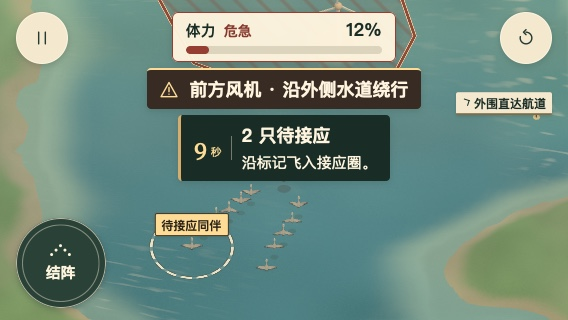

# 《羽与潮》UI / UX 审计与改版提案

2026-11-21 · Web 0.1.0 工作目录 · 主审斑头雁 S0–S6 旅程与共享界面

**推荐「湿地航记」方向。** 晨雾标题和三种栖息地已经建立了本作的视觉识别。商业化打磨应集中在飞行中的信息位置与操作反馈，让玩家在小屏上先看见下一步，再看见体力、队尾和路线。发布前先修复一个已复现的键盘问题：落脚暂停时，焦点停在「继续落脚」，按 Enter 却直接回到标题。

## 1. 项目与审计范围

| 项目          | 当前实现与设计依据                                                                                                                                                                                                                                                    |
| ------------- | --------------------------------------------------------------------------------------------------------------------------------------------------------------------------------------------------------------------------------------------------------------------- |
| 玩法          | 玩家控制领队转向、调速、观察、结阵并接应掉队同伴。斑头雁旅程须 12 只全部落脚。途经岔路、危险和补给点，穿插安全的观景与休整。                                                                                                                                          |
| 目标玩家      | 以愿意欣赏水彩自然场景、并乐于主动带队的玩家为首航设计对象。首次接触双手触控、从键鼠切换、需要镜像或减弱动态均是本审计的使用情境。玩家画像为设计推断，待首次玩家试玩验证。                                                                                            |
| 平台与画面    | 桌面浏览器、iPhone Safari 和 iPad Safari 横屏优先。Three.js `WebGLRenderer` 在 Canvas 绘制 XZ 模拟之上的 2.5D 正交画面，三维景物与水彩材质呈现前方路径、队伍和天气变化。                                                                                              |
| UI 技术与结构 | Vite、严格 TypeScript、原生 HTML/CSS/SVG。DOM 覆盖 Canvas。标题、物种选择、飞行 HUD、世界标记层和原生 `dialog` 定义在 `index.html`。暂停、操作帮助、失败、抵达及存档选择复用 `#panel`。设置和原声各有独立弹窗。`main.ts` 同时负责生命周期、物种 HUD 分发及 DOM 写入。 |
| 输入与数据    | `InputManager` 按 `pointerId` 在按下时分配职责，以 42% 为非鼠标移动区边界，支持镜像、指针捕获、键鼠、能力保持或切换，以及 A/B 镜头相对映射。镜头进入 `CameraDirector`。HUD 按快照、规则谓词和事件更新，接应与落脚读取模拟状态。                                       |
| 当前开放范围  | 默认生产预览显示雁可开始、鲸和鹿「尚未开放」。代码在开发或 `VITE_FEATHER_WHALE=1` 时开放鲸，并支持 `VITE_FEATHER_REINDEER=1` 开放鹿原型。ADR-010 对鹿写的是始终关闭，和当前预览开关存在文档差异。发行素材应按实际构建核对开放态。                                     |

依据为 [AGENTS.md](../AGENTS.md)、根目录的 [GDD v2.0 §1–5、§8、§13、§15.1、§16](../Feather_Tide_Gameplay_Design_v2.0.md)、[TDD v1.0 §2、§4、§9、§12](../Feather_Tide_Threejs_TDD_v1.0.md)、[ADR-009 双手原型](adr/009-dual-hand-camera-controls.md) 和 [ADR-010 旅程入口](adr/010-journey-only-entry.md)。本审计采用 GDD §15.1 的更新，斑头雁可操作时常驻体力条和百分比。A/B 默认选型仍待实机。实现入口见 [DOM 骨架](../index.html#L13-L194)、[手势分配](../src/input/input.ts#L99-L146)、[输入映射](../src/input/input.ts#L244-L273)、[渲染器](../src/rendering/scene.ts#L135-L182)、[镜头](../src/rendering/camera.ts#L29) 与 [物种开关](../src/app/main.ts#L153-L170)。

## 2. 浏览器证据

Playwright 1.65.1 访问本地默认生产预览，使用 Chromium 159.0.8154.6 与 WebKit 27.2。矩阵包括 1440×900 桌面、734×343 手机维度、568×320 压力尺寸、852×393 横屏触控模拟、1194×834 平板尺寸、393×852 竖屏。尺寸为 CSS 像素。标题、物种选择、S0、暂停和设置经正常入口操作截图。S2–S6 与失败样本通过测试夹具重放到目标快照，写入独立浏览器的 IndexedDB，再走游戏原有继续入口。冲突帧、体力触底和接应超时使用明确设置的测试状态，由实际游戏 tick 与界面呈现。尺寸运行在浏览器模拟环境，实机安全区、手掌遮挡、VoiceOver 与首航理解度均待验证。

| 证据                                                                                                                                                                                    | 环境与可复核内容                                                                                                            |
| --------------------------------------------------------------------------------------------------------------------------------------------------------------------------------------- | --------------------------------------------------------------------------------------------------------------------------- |
| [01 标题](ui-audit/01-title-desktop.jpg) · [02 物种](ui-audit/02-species-desktop.jpg) · [物种竖屏](ui-audit/species-portrait.png)                                                       | Chromium 1440×900 与 WebKit 393×852。晨雾构图、入口焦点、锁定状态、三栏到纵向排列。                                         |
| [03 S0 桌面](ui-audit/03-s0-desktop.jpg) · [04 S0 手机](ui-audit/04-s0-phone.jpg) · [11 S0 平板](ui-audit/11-s0-tablet.jpg)                                                             | 桌面的 WASD 提示与触屏起飞指令，及体力、上下角控制的相对占位。                                                              |
| [05 暂停](ui-audit/05-pause-desktop.jpg) · [06 设置](ui-audit/06-settings-desktop.jpg) · [07 小屏设置](ui-audit/07-settings-small.jpg) · [08 竖屏中断](ui-audit/08-rotate-portrait.jpg) | 从暂停打开设置，Esc 回到「设置」按钮且旅程保持暂停。短横屏设置需要滚动，返回固定。竖屏显示「请横置屏幕」。                  |
| [09 S2 岔路](ui-audit/09-fork-small.jpg) · [19 S3 接应](ui-audit/19-s3-rescue.jpg) · [10 S4 并发](ui-audit/10-hazard-rescue-small.jpg) · [20 S5 低体力](ui-audit/20-s5-low-stamina.jpg) | WebKit。S2 尚未选路。S4 是镜像、放大、配乐关、减少动态，12% 体力、9 秒、两只待接应的压力帧。S3、S5 为单一接应和低体力参照。 |
| [12 体力耗尽](ui-audit/12-failure-energy.jpg) · [13 接应超时](ui-audit/13-failure-rescue.jpg)                                                                                           | Chromium 852×393。两种中断原因与从 A 重试的入口。体力失败样本已点重试并恢复飞行。                                           |
| [14 等待 11/12](ui-audit/14-waiting-11.jpg) · [15 降落 12/12](ui-audit/15-landing-12.jpg) · [16 抵达结果](ui-audit/16-arrival.jpg)                                                      | Chromium 852×393，使用真实 S6 终点。先等待，最后一只进入后才演出，结算保留背景景观。                                        |
| [17 落脚暂停](ui-audit/17-landing-paused.jpg) · [18 Enter 后标题](ui-audit/18-landing-enter-title.jpg) · [21 镜像摇杆边缘](ui-audit/21-mirrored-stick-edge.jpg)                         | Chromium 键盘复现，以及 WebKit 568×320 镜像大摇杆靠边的合成触点。                                                           |



**验证记录。** 运行了现有 Playwright 入口、键盘首航、短横屏设置、Chromium 原生双触点、S4 并发、竖屏暂停落脚、S6 11→12 及单次写入的定向子集，共 18 通过、2 因平台条件跳过。录像手感、完整 S0–S6 手动通关和完整测试套件未覆盖。仓库初始状态为 `main` 尚无提交，无法与历史提交对比。`npm run build` 在 [`whale-world 2.ts` 第 212 行](../src/simulation/whale-world%202.ts#L212) 的 TS2345 停止，单独运行 Vite 打包成功并供本次生产预览使用。用例见 [入口与尺寸](../tests/e2e/species-entry.spec.ts)、[输入与设置](../tests/e2e/flight.spec.ts) 和 [救援与落脚](../tests/e2e/recovery.spec.ts)。

## 3. 界面审计

| 维度                             | 已有优点                                                                                                                                                                           | 具体问题与影响                                                                                                                                                                                                                                                                                                                                                                                                                                                                                                                                    |
| -------------------------------- | ---------------------------------------------------------------------------------------------------------------------------------------------------------------------------------- | ------------------------------------------------------------------------------------------------------------------------------------------------------------------------------------------------------------------------------------------------------------------------------------------------------------------------------------------------------------------------------------------------------------------------------------------------------------------------------------------------------------------------------------------------- |
| **Visual Hierarchy 视觉层级**    | [01](ui-audit/01-title-desktop.jpg) 的标题、进入、次级功能层级明确。[12](ui-audit/12-failure-energy.jpg)、[13](ui-audit/13-failure-rescue.jpg) 的重试按钮一眼可辨。                | [10](ui-audit/10-hazard-rescue-small.jpg) 的第一位置给体力，危险居第二，接应动作与时间第三。顺序由 DOM 和同一列网格固化。危险仍有高对比，但紧急度没有决定稳定的视线落点。见 [HUD DOM](../index.html#L193-L252) 和 [飞行信息网格](../src/app/style.css#L489-L504)。                                                                                                                                                                                                                                                                                |
| **Layout 布局**                  | 触屏工具在边缘，HUD 不拦截空白处手势。三联画横向转纵向有明确规则。                                                                                                                 | [06](ui-audit/06-settings-desktop.jpg) 到 [07](ui-audit/07-settings-small.jpg) 始终用设置双列排版直到宽度 ≤480px。568×320 时，镜头列填满首屏，配乐与减少动态从 y≈329px 才开始；首屏没有明显的内容继续提示。见 [设置标记](../index.html#L336-L401) 与 [设置滚动和断点](../src/app/style.css#L1005-L1073)。                                                                                                                                                                                                                                         |
| **Gameplay Visibility 游戏视野** | [03](ui-audit/03-s0-desktop.jpg)、[11](ui-audit/11-s0-tablet.jpg) 的大画面让队伍与湿地成为主角。S4 定向用例通过关键标记不互叠的几何检查。                                          | [10](ui-audit/10-hazard-rescue-small.jpg) 顶部信息组高 168.8px，占 320px 高度的 52.8%，底边约 y=181。这个数值衡量纵向占用，三块并非铺满整屏。图中卡片压在前方风机扫掠轮廓上，能看见两侧边线，但中间一段被盖住。避让算法保护控件和文字矩形，领队、航线前方与危险几何投影未作为避让输入。见 [HUD 尺寸](../src/app/style.css#L568-L615)、[避让输入](../src/app/main.ts#L142-L152) 和 [标记排布](../src/app/goose-marker-layout.ts#L106-L159)。                                                                                                       |
| **Interaction 交互**             | 44×44 暂停和复位，能力默认约 73px、放大约 90px。能力有形成进度环与文字状态；指针跨区行为在定向测试中正常。                                                                         | [17 → 18](ui-audit/18-landing-enter-title.jpg) 落脚暂停后，Enter 越过有焦点的「继续落脚」。[21](ui-audit/21-mirrored-stick-edge.jpg) 另外显示浮动摇杆接受了靠边触点，但大环超出画布。见 [全局 Enter](../src/app/main.ts#L2539-L2542)、[落脚暂停动作](../src/app/main.ts#L537-L554)、[摇杆原点](../src/input/input.ts#L137-L143) 和 [摇杆样式](../src/app/style.css#L781-L802)。                                                                                                                                                                   |
| **Consistency 一致性**           | 纸色、深墨、暖金和标题衬线从标题延伸到暂停与结算。风险三角、接应计时和队形阶段使用不同符号或文字。                                                                                 | [03](ui-audit/03-s0-desktop.jpg)、[04](ui-audit/04-s0-phone.jpg) 的飞行读数有较强的角色；[06](ui-audit/06-settings-desktop.jpg) 则混用浏览器原生复选框、滑轨、选择器及折叠符号，功能可用，状态反馈随浏览器而异。原型鲸的深度、呼吸和鹿的等候应使用同一套语义与控件规格，保留物种特有读数。见 [基础字色与焦点](../src/app/style.css#L1-L73)、[设置表单](../index.html#L336-L401) 和 [物种布局覆盖](../src/app/style.css#L1169-L1196)。                                                                                                             |
| **Responsive 适配**              | [02](ui-audit/02-species-desktop.jpg) 与 [物种竖屏](ui-audit/species-portrait.png) 均可辨认三种生物，竖屏飞行能暂停并要求横置。[07](ui-audit/07-settings-small.jpg) 返回按钮固定。 | 手机宽屏时的 18px 主提示和 15px 说明值得保留。短屏断点主要收紧间距、内边距与说明字号，并发时仍使用纵向叠放。[04](ui-audit/04-s0-phone.jpg)、[10](ui-audit/10-hazard-rescue-small.jpg)。安全区变量已存在，实机刘海和手指覆盖范围须用不同方向横握复核。见 [安全区变量](../src/app/style.css#L15-L18) 和 [小高度 HUD](../src/app/style.css#L600-L615)。                                                                                                                                                                                              |
| **Aesthetics 美术气质**          | [01](ui-audit/01-title-desktop.jpg)、[02](ui-audit/02-species-desktop.jpg) 的晨雾与栖息地三联画辨识度最高，[16](ui-audit/16-arrival.jpg) 的偏侧结算留出了抵达画面。                | [05](ui-audit/05-pause-desktop.jpg)、[12](ui-audit/12-failure-energy.jpg)、[13](ui-audit/13-failure-rescue.jpg) 共享居中方纸与整屏暗幕，仅靠标题、边框和文字体现情绪差别。可让休息、再出发、抵达有各自构图，通过保留队伍与栖地让场景表达情绪。见 [弹窗共用样式](../src/app/style.css#L920-L937) 与 [结果变体](../src/app/style.css#L974-L1003)。                                                                                                                                                                                                  |
| **Accessibility 可访问性**       | 初始键盘路径、原生模态焦点、图标按钮命名、体力文字和两类播报通道已有基础。危险文字 #FFF5DF / #382B23 的计算对比 12.60:1，接应标记文字 #292318 / #FFDC96 为 11.82:1。               | [09](ui-audit/09-fork-small.jpg) 的两条路线和 [10](ui-audit/10-hazard-rescue-small.jpg) 的接应目标依赖 12px 世界文字，且标记层 `aria-hidden`。S2 警告宣告有两侧航标，两个取舍只出现在视觉标记。接应播报有当前动作与时间阈值，仍没有相对方向等价。WebKit 568×320 的灵敏度原生滑轨可测高度 16px，移动方向选择器 25px；对应行有 44px，需扩实际操作热区并实机复测。见 [标记与播报](../index.html#L180-L192)、[文字尺寸](../src/app/style.css#L808-L827)、[触控字段](../src/app/style.css#L1047-L1072) 和 [播报生成](../src/app/main.ts#L1670-L1692)。 |

### 3.1 优先修复与关键设计问题

**A01 · P0 · Enter 越过落脚暂停。** 将 S6 推进到 12/12，在演出期间按暂停，自动化确认「继续落脚」拥有焦点。用 Playwright 键盘按一次 Enter，观察到 `#panel-title` 变为「一起抵达」，随后标题页可见。与鼠标点继续的既有用例是不同路径。代码在所有 `landing` 阶段全局处理 Enter，却未检查暂停弹窗或焦点。保留原生焦点激活，将跳过限定在显式跳过按钮或明确的独立快捷键；每个动作只消费一次。见 [前](ui-audit/17-landing-paused.jpg)、[后](ui-audit/18-landing-enter-title.jpg)、[动作重建](../src/app/main.ts#L405-L436) 和 [落脚 Enter](../src/app/main.ts#L2539-L2542)。

**A02 · P1 · 危险、救援与体力并发时，行动和方向之间脱节。** [S4 压力帧](ui-audit/10-hazard-rescue-small.jpg) 同时看得到「沿外侧水道绕行」和「沿标记飞入接应圈」，两条行动分别指向画面右侧和左下，读卡片时需要再搜索目标。救援分支优先占用主提示，低体力所带来的「加速受限」或恢复动作让位；该帧只保留「危急 12%」。浅湾细节被腾空。两条关键行动都应保留，给绕行和接应各自稳定位置与对应图形，恢复动作按安全性延后。S2 两条分支继续同时呈现，[S5 单一低体力](ui-audit/20-s5-low-stamina.jpg) 的恢复方向继续保留。见 [现有危险文案](../src/app/flight-guidance.ts#L274-L305)、[体力补救](../src/app/flight-guidance.ts#L442-L460) 和 [冲突选择](../src/app/main.ts#L1394-L1449)、[危险细节压缩](../src/app/main.ts#L1640-L1693)。

**A03 · P1 · 首航提示清楚，动作与反馈相距较远。** [手机 S0](ui-audit/04-s0-phone.jpg) 中起飞指令位于上方，手需要去左侧空白区域；常驻「跳过飞行教学」占用移动侧左下约 116×44px，右下同时展示尚未教到的结阵。镜像后跳过移到右下，仍占移动侧。另在 568×320 镜像放大时，用合成触点从命中 Canvas 的 (557, 279) 推起摇杆，[边缘截图](ui-audit/21-mirrored-stick-edge.jpg) 的 128px 大环被右和下边裁掉。将整套跳过操作集中在暂停帮助，首航需要跳过时在提示附近提供足够大的次要动作；首个触点和观察方向用短暂、穿透命中的提示关联。评估摇杆视觉边界缩裁或内移，以及看得见的位移轴和真实推程的一致性。见 [S0 教学状态](../src/app/goose-teaching.ts#L62-L125)、[跳过位置](../src/app/style.css#L706-L718) 和 [触点与推程](../src/input/input.ts#L137-L173)。

**A04 · P1 · 设置查找与操作成本。** [07](ui-audit/07-settings-small.jpg) 上「宽幅鼠标环绕」占了触屏首屏，触屏能立即用到的配乐和减少动态在下方。滑轨缺少可读档位或当前数值，初次试调不易比较。短横屏可用四个可键盘访问的分类入口与固定返回，默认先显示当前输入相关控制，提供键鼠选项的明确位置。保留镜像、放大、能力保持或切换与 A/B 配置的已有值及即时应用行为。见 [表单](../index.html#L336-L401)、[设置同步](../src/app/main.ts#L303-L315) 和 [设置事件](../src/app/main.ts#L2503-L2518)。

**A05 · P1 · 旅程入口和暂停应说清下一步。** 初次选择时 [02](ui-audit/02-species-desktop.jpg) 只给物种名与开放状态。可给雁用一行描述「带 12 只雁穿过湿地与风场」，以旅程目标建立预期。有雁存档时静态主按钮仍写「开始旅程」却可能打开继续对话框，另有「继续 · 芦苇洲」直达，属于代码审查发现。建议存档存在时把「继续 · 芦苇洲」变成主行动，「重新起飞」明确打开选择；保存写入失败或读档无效仍要直说当前选择。暂停的「飞行操作」继续作为随时可重新查看的帮助。见 [选择入口](../index.html#L83-L140)、[继续入口更新](../src/app/main.ts#L782-L794)、[检查点操作](../src/app/main.ts#L945-L986) 与 [暂停摘要](../src/app/main.ts#L484-L534)。

**A06 · P2 · 失败与抵达的画面节奏。** [12](ui-audit/12-failure-energy.jpg)、[13](ui-audit/13-failure-rescue.jpg) 语气温和且原因明确，建议把「体力耗尽」或「接应时间已到」放在标题后的第一行，并把重启地点与恢复信息靠近重试按钮。保持 [14](ui-audit/14-waiting-11.jpg) 的「等待同伴」、[15](ui-audit/15-landing-12.jpg) 的演出读数和 [16](ui-audit/16-arrival.jpg) 的结果分工。结算将地名、全队人数和经过路线排成三层，让雁群与落脚地仍出现在旁边。见 [失败反馈](../src/app/main.ts#L1058-L1109)、[落脚谓词接入](../src/app/main.ts#L1304-L1350) 与 [结果弹窗](../src/app/main.ts#L1159-L1183)。

## 4. 三套优化方向

下列成本为斑头雁及共享壳层的相对估算，含界面实现和浏览器回归，不计真实设备招募与其他物种逐段重新编排。

| 方向                     | 视觉风格                                                                                                                 | HUD 与布局策略                                                                                                                                                                         | 交互设计                                                                                                                         | 成本与主要风险                                                                                                                       |
| ------------------------ | ------------------------------------------------------------------------------------------------------------------------ | -------------------------------------------------------------------------------------------------------------------------------------------------------------------------------------- | -------------------------------------------------------------------------------------------------------------------------------- | ------------------------------------------------------------------------------------------------------------------------------------ |
| **A · 湿地航记（推荐）** | 标题保留水彩三联画与晨雾。飞行读数用小面积浅纸和深墨，警告用高对比底色与明确符号。地名与结算用宋体，指令与数据用无衬线。 | 固定顶部两侧留给暂停、复位；体力贴近上沿一侧，硬危险使用高优先顶部槽位。救援以计时和动作组成紧凑提示；世界层负责方向与目标，分支用一项取舍说明。小屏允许错列或并排，始终留出中部航线。 | 教学一次只练一个动作，靠近操作侧的提示随首个有效动作退场。右手空白拖镜和固定能力位置保持肌肉记忆；暂停收纳操作帮助和舒适性设置。 | **中**。沿用 DOM、世界标记和现有美术。主要工程是提示编排与避让。需实测高密度帧、字体放大、来回拖镜时的稳定性。                       |
| **B · 世界航标**         | 重点投入航标、风纹、芦苇岸线、队伍几何与接应环，使指引像栖地的一部分。                                                   | 体力与工具贴安全边，路线和队伍状态主要由世界标记传达。紧急状态升为屏幕提示，离屏时用边缘方向与短标签。                                                                                 | 玩家通过转镜解读地形与路径；相机遮挡或减弱动态时切换同义的简明文字与固定方向提示。                                               | **高**。需改 Three.js 遮挡、层次和各关美术，核对轮廓同源与低性能设备表现。最大风险是默认镜头及低视觉敏感度玩家错过危险。             |
| **C · 领队指北**         | 用简洁、坚固的刻度、箭头和清晰的状态纹样表达领队工具，画面侧边像一条窄航图。                                             | 常驻小型边缘方位、体力与队伍状态；已确认路线、危险、接应在同一指北区域轮换，世界只留必要锚点。平板与桌面展开信息，手机仅保留紧急和下一步。                                             | 对不常拖镜的玩家更直观；可选辅助档提供更明确的方位文字、较大读数。与镜头旋转一致更新方位。                                       | **中高**。需定义并验证何时显示可推导方位和队形数据；双路线、救援与风机同时出现时容易把注意力带到屏幕边缘，常驻读数也会占用观景空间。 |

### 4.1 选 A 的理由与布局规范

实际问题集中在上中部叠层与多提示互相抢位置。A 优先调整阅读顺序和提示与目标的关联，工作量主要在表现层。它沿用已经有辨识度的栖息地美术、能看见成员的 2.5D 构图、读屏通道与真实几何锚点，适合先在 S0、S4、S6 做三帧原型，分别检验新手、最拥挤和抵达。

```text
横屏默认构图 · 示意

暂停   体力 78%             ⚠ 前方风机 · 走外侧水道       复位
                            ◇ 接应 9 秒 · 进入接应圈

                开放的航线、领队与队伍可见区
    [世界锚点：外侧水道]                     [边缘：◇ 同伴方向]

移动侧空白 / 触碰后出现摇杆       观察侧空白                  结阵
```

- **用状态决定出现时机。** 平稳飞行只保留控件、体力与阶段所需的地标。章节名短暂出现。危险与接应并发时，危险文本和对应方向固定在第一层，接应保留最早到期目标、倒计时和一个动作。体力条与百分比常驻，恢复建议顺延到可行动的时机。贴边箭头用安全边距和来源一致的符号。左右图示为排版示意，实际方向由当前镜头投影。
- **用动词和目标写提示。** S2「短山口 · 路短／侧风强」「长湖路 · 路长／沿岸可补给」，就近展示在各自入口。S3「接应 9 秒 · 进入接应圈」，近圈后切换为「缓行并留在圈内」。S4「前方风机 · 走外侧水道」。S6「等待同伴 11/12 · 放慢，等队尾跟上」。名称、去向、补给资格和风险来自当下数据。
- **字和材质。** 沿用深墨与纸色取样，提示文字用现有无衬线，宋体保留给地名、序幕和结果。小横屏主提示至少 18px，说明至少 15px，关键世界方向文字建议 14px 起并允许紧凑换行。减少动态用静态位移与明暗状态表达，无需靠脉冲闪动来辨认。触控门槛拟用 44×44 CSS px，放大方案用现有 52px 工具规格作起点。普通文本以 4.5:1、关键非文本图形以 3:1 验收，半透明肤色、阴影与动态场景按合成背景复测。见 [GDD §15.1](../Feather_Tide_Gameplay_Design_v2.0.md#151-斑头雁-hud-可读性补充2026-11-18) 和 [WCAG 2.2 对比度与目标尺寸](https://www.w3.org/TR/WCAG22/)。
- **控制提示随输入变化。** 触屏显示手势动词和空白操作侧，键鼠显示当前绑定。镜像后移动与观察说明和能力键共同成对切换。暂停、设置、帮助采用正常返回和焦点复位路径。首次玩家保持两指便可完成所有关键动作。缩短信息阅读路径优先于改变镜头 A/B 的默认行为。
- **视野按航行任务验收。** 在 568×320 压力态，以顶部信息组约 128px 为首轮原型预算，包含所有紧急状态；若字号或文本超预算，移次级信息到边缘或延后出现。以领队投影、前方航线与危险有效边缘实测，检查关键轮廓在约 3 秒巡航反应窗口内持续可辨。预算为原型指标，需结合真机和 GDD 公平性验收。

## 5. 实施计划

| 优先级                                       | 组件、文件、范围                                                                                                                                                                                                 | 可执行验收                                                                                                                                                                                                                                                                                                  |
| -------------------------------------------- | ---------------------------------------------------------------------------------------------------------------------------------------------------------------------------------------------------------------- | ----------------------------------------------------------------------------------------------------------------------------------------------------------------------------------------------------------------------------------------------------------------------------------------------------------- |
| **P0 · 落脚键盘与模态焦点（A01）**           | `main.ts` 的 `showPanel`、落脚事件和 Enter 路由；`index.html` 的演出跳过与模态按钮；扩展 `tests/e2e/recovery.spec.ts`。小 PR，约 1–2 人日。                                                                      | 12/12 时暂停，Enter 和 Space 在「继续落脚」上只恢复演出，Tab 到「跳过落脚演出」再激活才立即结算。未再确认时结果停留可读；「返回标题」只在该按钮被激活时发生。测试普通暂停、竖屏暂停、点击继续及快速重复输入。11/12 不能进入演出，写入仍一次。                                                               |
| **P1 · 飞行 HUD 阅读顺序与航线视野（A02）**  | `index.html` HUD 槽位、`style.css` 断点、`main.ts` 雁提示选择、`flight-guidance.ts` 与 `goose-marker-layout.ts`。先实现一个小型只读 HUD 视图模型，输出危险、接应、体力、教程及路标身份；复用当前数据和碰撞轮廓。 | 用 S2 无路由、S3 圈外/圈内、S4 12%+9 秒+两只掉队、S5 可补给/耗尽和 S6 等待截图做固定回归。危险与最急接应都保留文字及方向，聚焦区无侵入遮挡；对比默认与回望、低/高俯角及低画质。计时不逐秒语音播报，危险阈值与方向有去重的等价文案。T14、V2-07/09/11/12/15/18 通过并人工核对扫掠边界。                       |
| **P1 · 触控发现、镜像与短屏设置（A03–A04）** | `goose-teaching.ts`、`input.ts` 的摇杆显示边界、`index.html` 设置结构、`style.css` 和 `desktop-settings.ts`。滑轨扩大接触范围并显示数值，键位与触屏设置按场景可达。                                              | 568×320、现代 iPhone 横屏及 iPad 横屏下验证左右换手和放大。拖镜越键不触发能力、按能力滑出不转镜、暂停和转屏全部清输入；测试从边缘及工具旁合法触点起手，摇杆的方向和推程可见且与输入一致。返回固定且滚动只动内容；关键字段可 Tab、系统辅助方式、手指拖动操作。GDD V2-01–08、V2-17–18 和 T18 的相关子集通过。 |
| **P1 · 旅程入口和存档可理解性（A05）**       | `index.html` 物种按钮与状态说明、`style.css` 栖地版式、`main.ts` 的 `refreshMenuSaves`、`choose`；扩展 `species-entry.spec.ts`。                                                                                 | 第一次开局、存档继续、明确重开、坏档、上次已抵达、开放原型和等待载入可区分。保留 ADR-010 的标题确认、仅旅程与旧漫游隔离。各状态用键盘和触屏完成入口；在默认构建与显式原型构建核对三个物种标签。T17、T23 通过。                                                                                              |
| **P2 · 统一航记视觉与各类结果（A06）**       | `style.css` 统一语义色、字号、边距、图标和焦点规格；`index.html`、`main.ts` 的暂停/重试/抵达结构；先雁后鲸鹿原型校对。                                                                                           | 对标题、物种、暂停、两类失败和抵达保存同尺寸前后图。结果包括地点、人数与路线；失败从画面、文字、主操作就能辨认原因与重试地点。默认、静音、减弱动态、200% 桌面文字放大、窄横屏和低画质下关键信息可达。缩短转场时保留上下文，无新增必读正文。                                                                 |

建议实施顺序为先独立交付 P0，再用固定截图状态验证 A 方案的槽位原型，之后合入设置、入口与视觉。P1 初估 6–10 人日，P2 初估 3–5 人日。每批只改相应责任域，先复用已有提示、标记优先级和快照，不重写物种模拟。若现有飘移和镜头数据难以保护前方视野，先做投影避让实验并记录取舍，再决定是否进入镜头调整。UI 行动仍通过现有命令；胜负、固定 tick、接应目标、快照及危险几何由既有规则维护。

**上线验收。** 在上表浏览器矩阵外，加测真实 iPhone Safari、有刘海与无刘海的双方向横握、真实 iPad Safari、混合触控与键鼠、系统字体放大与 VoiceOver，并复用现有 [首航与设备执行单](plans/goose/execution/playtest-handoff.md)。邀请 5–8 位首航玩家，记录首次移动和转镜、S2 能否说出两路取舍、S3 是否能无需指导找到同伴，以及 S4 看见警告到开始绕行的用时。以至少四位在五人样本中完成关键任务为初始对照，另记录失手、遮挡、误判的实际原因。默认镜头和关闭配乐都要能判断危险、方向、恢复点与队伍状态。首次玩家记录、真机验证与构建门禁齐备后再判断发布就绪。
